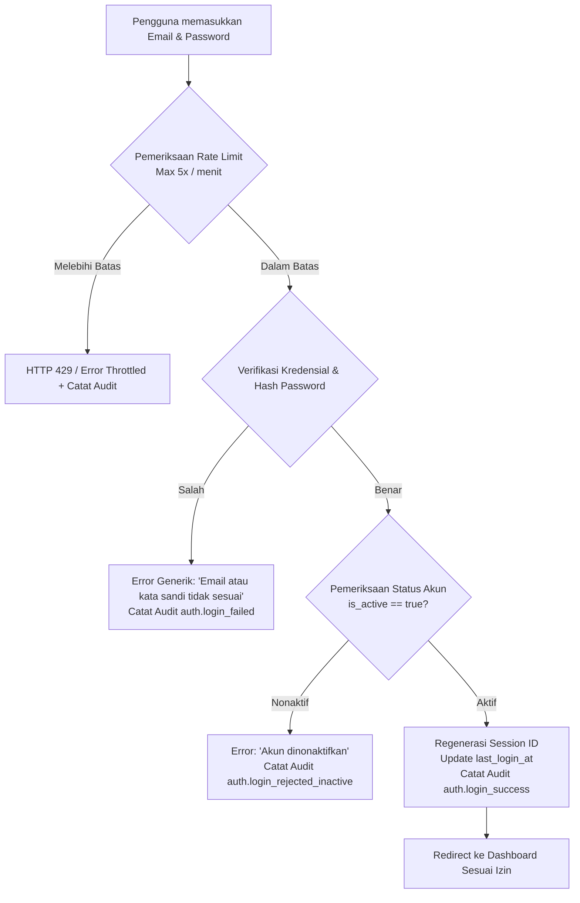

# Dokumentasi Autentikasi, Otorisasi & RBAC (Authentication & Access Control)

| Metadata | Nilai |
|---|---|
| Status | **Diimplementasikan (Tahap 02 — Selesai)** |
| Owner | Lead Engineer / Backend Lead |
| Versi/Release | 1.0.0 |
| Terakhir Ditinjau | 2026-11-17 |
| Sumber Terkait | `prd.md` (§4, §5.1, §6.1, §14.1, §14.2), `app/Http/Controllers/Auth/*`, `app/Http/Middleware/*` |

---

## 1. Tujuan & Cakupan
Dokumen ini menjelaskan implementasi autentikasi pengguna, otorisasi berbasis peran (Role-Based Access Control / RBAC), kebijakan pembatalan sesi (*session invalidation*), penegakan izin (*permission enforcement*), dan perlindungan hak kepemilikan data (*resource ownership / anti-IDOR*) pada KasirPro.

---

## 2. Alur Autentikasi (Authentication Lifecycle)



### 2.1 Fitur Utama Autentikasi (FR-AUTH-01, FR-AUTH-02)
- **Login:** Ditangani oleh `App\Http\Controllers\Auth\LoginController@store` menggunakan `LoginRequest`.
- **Pencegahan Enumerasi Akun:** Pesan kesalahan login dibuat identik baik jika email tidak terdaftar maupun jika kata sandi salah:
  > *"Email atau kata sandi yang Anda masukkan tidak sesuai."*
- **Regenerasi Session ID:** Setiap kali login berhasil, `$request->session()->regenerate()` dijalankan untuk mencegah serangan *Session Fixation*.
- **Rate Limiting:** Percobaan login dibatasi maksimal 5 kali per menit per kombinasi email dan IP address (`admin@kasirpro.local|127.0.0.1`). Jika melebihi batas, request ditolak dan dicatat di audit log.
- **Logout Aman:** Memanggil `Auth::logout()`, `$request->session()->invalidate()`, dan `$request->session()->regenerateToken()`.

### 2.2 Pembatalan Sesi Akun Nonaktif (Session Invalidation)
Sesuai PRD §14.1, akun yang dinonaktifkan oleh administrator dilarang tetap dapat menggunakan sesi aktif pada request berikutnya:
- Middleware `App\Http\Middleware\EnsureAccountIsActive` terdaftar secara global pada grup `web`.
- Pada setiap HTTP request yang terautentikasi, middleware memeriksa kolom `users.is_active`.
- Jika `is_active === false`, sesi langsung diinvalidasi seketika, user di-logout, dicatat di audit log (`auth.session_terminated_inactive`), dan dialihkan ke halaman login dengan pesan:
  > *"Akun Anda telah dinonaktifkan. Silakan hubungi administrator."*

---

## 3. Matriks Peran & Hak Akses (RBAC Matrix)

KasirPro menerapkan kontrol akses berbasis izin granular (*permission-based*), bukan sekadar memeriksa string nama peran.

### 3.1 Tiga Peran Baku (Roles)
1. **Admin (`admin`):** Administrator sistem dengan 37 izin penuh, mencakup konfigurasi, pengguna, transaksi, persetujuan, dan audit.
2. **Supervisor (`supervisor`):** Pengawas operasional dengan 27 izin, berwenang menyetujui diskon khusus, verifikasi transfer bank, retur barang, penerimaan barang, stok opname, dan laporan terbatas.
3. **Kasir (`cashier`):** Petugas kasir dengan 7 izin fokus operasional meja kasir (pencarian produk, buat penjualan, diskon standar, retur request, dan transaksi milik sendiri).

### 3.2 Matriks Hak Akses As-Built

| Modul | Kode Permission | Admin | Supervisor | Kasir |
|---|---|:---:|:---:|:---:|
| **Dashboard** | `dashboard.view` | ✓ | ✓ | ✓ |
| **Pengguna** | `users.manage` | ✓ | — | — |
| | `roles.manage` | ✓ | — | — |
| **Katalog & Produk** | `products.view` | ✓ | ✓ | ✓ |
| | `products.create` | ✓ | — | — |
| | `products.update` | ✓ | — | — |
| | `products.deactivate` | ✓ | — | — |
| | `catalog.manage` | ✓ | — | — |
| **Pemasok** | `suppliers.view` | ✓ | ✓ | — |
| | `suppliers.manage` | ✓ | ✓ | — |
| **Pengadaan (PO)** | `purchases.create` | ✓ | ✓ | — |
| | `purchases.confirm` | ✓ | ✓ | — |
| | `purchases.cancel` | ✓ | ✓ | — |
| | `receipts.create` | ✓ | ✓ | — |
| | `receipts.post` | ✓ | ✓ | — |
| | `supplier_payments.create` | ✓ | ✓ | — |
| | `supplier_payments.reverse` | ✓ | — | — |
| **Penjualan (POS)** | `sales.create` | ✓ | ✓ | ✓ |
| | `sales.discount.within_limit` | ✓ | ✓ | ✓ |
| | `sales.discount.override` | ✓ | ✓ | — |
| | `payments.verify_transfer` | ✓ | ✓ | — |
| | `sales.view_all` | ✓ | ✓ | — |
| | `sales.view_own` | ✓ | ✓ | ✓ |
| **Retur Penjualan** | `returns.request` | ✓ | ✓ | ✓ |
| | `returns.approve` | ✓ | ✓ | — |
| | `returns.refund` | ✓ | — | — |
| **Biaya Operasional** | `expenses.create` | ✓ | ✓ | — |
| | `expenses.post` | ✓ | ✓ | — |
| | `expenses.pay` | ✓ | ✓ | — |
| **Persediaan** | `inventory.view` | ✓ | ✓ | ✓ |
| | `inventory.adjust` | ✓ | ✓ | — |
| **Stok Opname** | `stock_opname.create` | ✓ | ✓ | — |
| | `stock_opname.count` | ✓ | ✓ | — |
| | `stock_opname.approve` | ✓ | ✓ | — |
| | `stock_opname.post` | ✓ | — | — |
| **Laporan** | `reports.view_all` | ✓ | — | — |
| | `reports.export` | ✓ | — | — |
| | `reports.view_limited` | ✓ | ✓ | — |
| **Pengaturan Toko** | `store_settings.manage` | ✓ | — | — |
| **Jejak Audit** | `audit.view` | ✓ | ✓ | — |

---

## 4. Penegakan Otorisasi Backend & Anti-IDOR

1. **Middleware `permission:<kode>`:**
   Mengecek `$user->hasPermission($code)`. Jika gagal, melempar HTTP 403 Forbidden dengan halaman error kustom yang menampilkan *Correlation Request ID*.
2. **Kebijakan Kepemilikan Data (*Resource Ownership Gate*):**
   Didefinisikan pada `AppServiceProvider`:
   ```php
   Gate::define('view-sale', function (User $user, int $saleCashierId) {
       if ($user->hasPermission('sales.view_all')) return true;
       if ($user->hasPermission('sales.view_own') && $user->id === $saleCashierId) return true;
       return false;
   });
   ```
   Kasir dilarang melihat transaksi milik kasir lain jika tidak memiliki izin `sales.view_all`.
3. **Kebijakan UserPolicy:**
   - Admin dilarang menonaktifkan atau menghapus akun aktifnya sendiri (`toggleStatus` dan `delete`).
4. **Prinsip Maker-Checker Verifikasi Transfer Bank (PRD §4.2, §6.4):**
   - Izin `payments.verify_transfer` hanya dimiliki oleh peran Admin dan Supervisor.
   - Kasir pembuat pesanan transfer dilarang keras mengesahkan atau memverifikasi transaksi miliknya sendiri (`$verifier->id !== $sale->cashier_id`).
   - Pengecualian (*Admin Override*): Administrator yang bertindak sebagai kasir dapat mengesahkan transaksinya sendiri hanya jika menyertakan alasan tertulis wajib (*override reason*) yang disimpan permanen ke dalam catatan audit trail.

---

## 5. Traceability Kebutuhan ke Automated Tests

| ID Kebutuhan | Deskripsi Kebutuhan | Berkas Test Penjamin | Status |
|---|---|---|:---:|
| `FR-AUTH-01` | Login aman, rate limit, penolakan akun nonaktif, regenerasi session | `tests/Feature/Auth/LoginTest.php` | **LULUS (7/7)** |
| `FR-AUTH-02` | Logout aman dan pembatalan sesi | `tests/Feature/Auth/LogoutTest.php` | **LULUS (2/2)** |
| `FR-AUTH-03` | Admin kelola pengguna, penugasan role, dan aktivasi status | `tests/Feature/UserManagementTest.php` | **LULUS (8/8)** |
| `FR-AUTH-04` | Penegakan otorisasi backend (403 default-deny, anti-IDOR) | `tests/Feature/AuthorizationTest.php` | **LULUS (6/6)** |
| `FR-AUTH-05` | Tampilan profil mandiri dan ubah kata sandi terverifikasi | `tests/Feature/Auth/PasswordSecurityTest.php` | **LULUS (3/3)** |
| `FR-AUD-01` | Pencatatan audit trail otomatis tanpa menyimpan rahasia/password | `tests/Feature/AuditLogTest.php` | **LULUS (2/2)** |
| `FR-SAL-05` | Maker-checker verifikasi transfer & admin override | `tests/Feature/Sales/TransferVerificationTest.php` | **LULUS (8/8)** |
