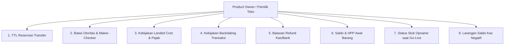
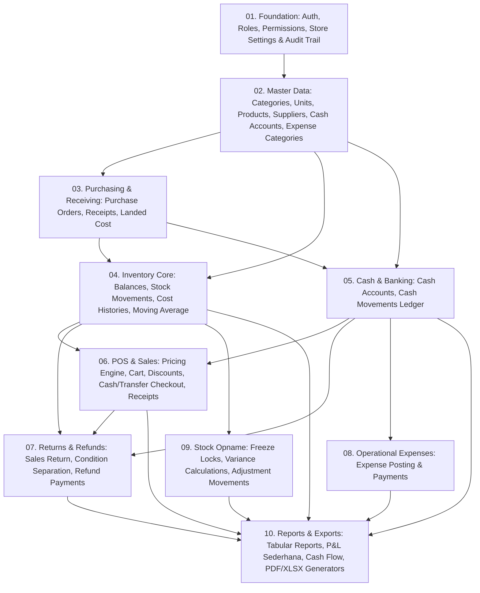
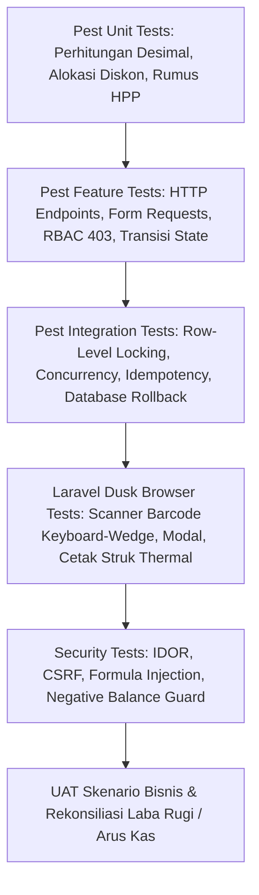

# Rencana Implementasi Sistem KasirPro (Implementation Plan)

| Metadata | Nilai |
|---|---|
| Status Dokumen | **Baseline Tahap 00 (Selesai)** — Menunggu Persetujuan Stakeholder untuk Tahap 01 |
| Pemilik Dokumen | Tim Pengembang KasirPro / Lead Software Engineer |
| Tanggal Efektif | 17 November 2026 |
| Target Rilis | MVP Retail Toko Tunggal (Single-Store) |
| Basis Dokumen | Product Requirements Document (`prd.md`) Versi 1.0.0 |
| Zona Waktu & Valuta | `Asia/Jakarta` (WIB) / Indonesian Rupiah (`IDR`) |

---

## 1. Ringkasan Sistem & Sasaran Produk

**KasirPro** adalah aplikasi web Point of Sale (POS) dan manajemen operasional toko retail, minimarket, serta usaha dagang kecil. KasirPro menjembatani pencatatan transaksi penjualan kasir, pengendalian persediaan barang, pengadaan barang (*purchasing*), retur penjualan, pencatatan biaya operasional, dan mutasi kas/bank riil.

### 1.1 Prinsip Fundamental Sistem
1. **Correctness First:** Perhitungan stok, biaya modal (HPP), dan arus kas wajib akurat secara matematis dan konsisten antara buku besar (*ledger*) dengan proyeksi saldo (*balances*).
2. **Server-Authoritative:** Logika bisnis, penetapan harga jual, alokasi diskon, status reservasi, dan nilai total transaksi mutlak ditentukan oleh server backend Laravel. Data dari antarmuka browser (client) tidak pernah dipercaya secara langsung.
3. **Auditability & Immutable Ledgers:** Setiap mutasi fisik barang dan uang aktual dicatat secara *append-only* di tabel buku besar (`stock_movements` dan `cash_movements`). Tidak ada operasi *UPDATE* atau *DELETE* pada catatan historis; pembatalan atau koreksi transaksi selalu dilakukan melalui *reversal* atau dokumen penyesuaian sah.
4. **Operasional Sederhana (Manual Verification):** MVP tidak mengintegrasikan otomatisasi perbankan (API bank / payment gateway / QRIS otomatis). Pembayaran transfer diverifikasi manual oleh manusia (Supervisor/Admin). Sistem juga bukan perangkat lunak akuntansi buku besar umum (*General Ledger / Neraca*), melainkan sistem ringkasan operasional toko (*Operational P&L*).
5. **No Negative Balance & Anti-Race-Condition:** Kuantitas stok tersedia (`available_quantity = on_hand - reserved`) dan saldo kas/bank dilarang bernilai negatif. Operasi kasir bersamaan (*concurrent checkout*) diamankan menggunakan transaksi database InnoDB dan penguncian tingkat baris (*pessimistic row-level locking*).

---

## 2. Ruang Lingkup Kebutuhan (Scope Breakdown)

### 2.1 Kebutuhan Inti MVP (P0 — Syarat Mutlak Go-Live)
Kebutuhan P0 merupakan alur transaksi fundamental yang harus lulus uji fungsional, integritas data, dan keamanan sebelum sistem dapat digunakan di toko:

- **Auth & Access:**
  - `FR-AUTH-01`: Login aman (regenerasi session ID, pesan generik kredensial salah, rate limiting, penolakan akun nonaktif).
  - `FR-AUTH-02`: Logout aman dan pembatalan session aktif.
  - `FR-AUTH-03`: Manajemen pengguna, penetapan 3 peran (Admin, Supervisor, Kasir), dan status aktif/nonaktif.
  - `FR-AUTH-04`: Penegakan otorisasi backend (Role & Permission via Middleware/Gate/Policy; 403 Forbidden).
  - `FR-AUD-01`: Pencatatan log audit otomatis atas seluruh tindakan mutasi data sensitif (tanpa menyimpan rahasia/password).
- **Master Data & Katalog:**
  - `FR-MST-01`: CRUD Kategori produk (nama dan slug unik, pencegahan hapus master terpakai).
  - `FR-MST-02`: CRUD Satuan unit barang (simbol unik, presisi desimal 0–3 angka di belakang koma).
  - `FR-MST-03`: CRUD Produk (SKU unik, Barcode unik atau NULL, harga jual non-negatif, stok minimum, status aktif).
  - `FR-MST-04`: Jejak riwayat perubahan harga jual (*price history tracking*).
  - `FR-MST-05`: CRUD Pemasok / Supplier (kode unik, status aktif).
  - `FR-MST-06`: CRUD Kategori biaya operasional dan Akun Kas/Bank (pencegahan hapus akun bermutasi).
- **Persediaan & Biaya Modal (Inventory & Costing):**
  - `FR-INV-01`: Integrasi Barcode Scanner USB (mode keyboard-wedge) pada layar POS.
  - `FR-INV-02`: Proyeksi saldo stok per produk terikat secara atomik dengan mutasi ledger dalam transaksi DB.
  - `FR-INV-03`: Buku besar persediaan (*Stock Ledger*) bersifat *append-only* dengan pencatatan nilai HPP saat kejadian.
  - `FR-INV-04`: Pencegahan mutasi yang menyebabkan stok tersedia bernilai negatif.
  - `FR-INV-05`: Deteksi status stok (*Available*, *Low Stock*, *Out of Stock*).
  - `FR-INV-06`: Perhitungan HPP Moving Weighted Average dinamis saat penerimaan barang diterima (*accepted receipt*).
- **Pengadaan Barang (Purchasing):**
  - `FR-PUR-01`: Pembuatan draft Purchase Order (nomor unik, supplier aktif, validasi kuantitas dan harga beli).
  - `FR-PUR-02`: Konfirmasi PO (perubahan status menjadi `ordered`, penguncian baris PO).
  - `FR-PUR-03`: Penerimaan barang bertahap/penuh (pencatatan barang diterima vs ditolak; barang ditolak tidak menambah stok fisik).
  - `FR-PUR-04`: Pencatatan pembayaran manual ke supplier (arus kas keluar tercatat riil; batas maksimal sesuai utang dagang).
- **Kasir & Penjualan (POS / Sales):**
  - `FR-SAL-01`: Pencarian cepat produk aktif berdasarkan Barcode, SKU, atau Nama.
  - `FR-SAL-02`: Manajemen keranjang belanja dengan kalkulasi presisi satuan.
  - `FR-SAL-03`: Kalkulasi harga final, diskon, dan subtotal yang sepenuhnya *server-authoritative*.
  - `FR-SAL-04`: Pembayaran tunai (validasi uang diterima >= grand total, kalkulasi kembalian, arus kas masuk instan).
  - `FR-SAL-05`: Pembayaran transfer bank manual (status `pending_payment`, reservasi stok dengan masa berlaku TTL, verifikasi manual oleh Supervisor/Admin).
  - `FR-SAL-06`: Pencegahan transaksi ganda melalui header `Idempotency-Key` (UUIDv4).
  - `FR-SAL-07`: Cetak dan cetak ulang struk belanja belanja (dukungan ukuran 58mm dan 80mm; snapshot data toko historis).
- **Diskon:**
  - `FR-DIS-01`: Diskon nominal dan persentase pada level baris item serta level header transaksi.
  - `FR-DIS-02`: Pembatasan batas wewenang kasir dan keharusan persetujuan (*maker-checker*) untuk diskon khusus.
  - `FR-DIS-03`: Alokasi proporsional diskon header transaksi ke tiap baris barang dengan penyelesaian sisa pembulatan deterministik.
- **Retur Penjualan (Returns & Refunds):**
  - `FR-RET-01`: Pengajuan retur dari transaksi selesai (validasi sisa kuantitas yang belum pernah diretur).
  - `FR-RET-02`: Alur persetujuan retur (*maker-checker* oleh Supervisor/Admin).
  - `FR-RET-03`: Retur kondisi layak jual (*resellable*): stok fisik bertambah dan HPP historis dipulihkan.
  - `FR-RET-04`: Retur kondisi rusak (*damaged*): barang tidak masuk stok jual, dicatat sebagai kerugian retur rusak.
  - `FR-RET-05`: Pembayaran pengembalian dana (*refund*) riil (arus kas keluar hanya tercatat saat uang diserahkan).
  - `FR-RET-06`: Pembaruan status transaksi penjualan (`partially_returned` atau `fully_returned`).
- **Biaya Operasional & Kas:**
  - `FR-OPEX-01`: Pencatatan dan posting biaya operasional toko (*Operational Expenses*).
  - `FR-OPEX-02`: Manajemen status pembayaran biaya (belum lunas, sebagian, atau lunas).
  - `FR-CASH-01`: Buku besar kas masuk dan kas keluar (*Cash Ledger*) yang terikat langsung ke akun kas/bank.
  - `FR-CASH-02`: Rekonsiliasi arus kas: Saldo Akhir = Saldo Awal + Total Masuk - Total Keluar.
- **Laporan & Ekspor:**
  - `FR-REP-01`: Laporan tabular terfilter (Penjualan, Pembelian, Retur, Biaya, Persediaan).
  - `FR-REP-02`: Laporan Laba Rugi Sederhana operasional (Net Sales - Net COGS = Gross Profit - Expenses - Opname Loss).
  - `FR-REP-03`: Laporan Arus Kas berdasarkan tanggal mutasi kas riil (`occurred_at`).
  - `FR-EXPORT-01`: Ekspor dokumen format PDF dan spreadsheet XLSX dengan sanitasi formula injection.
  - `FR-EXPORT-02`: Pengunduhan berkas privat (*authorized private download*).
- **Stok Opname & Operasional:**
  - `FR-STO-01`: Inisiasi sesi stok opname dengan pembekuan mutasi stok (*product lock*) untuk barang yang dihitung.
  - `FR-STO-02`: Perhitungan selisih fisik (*variance*) dan posting penyesuaian stok satu kali pasca persetujuan.
  - `FR-OPS-01`: Prosedur backup database/media dan uji pemulihan (*restore drill*).

### 2.2 Kebutuhan Lanjutan Versi Pertama (P1 — Pasca Stabilitas Inti)
- `FR-AUTH-05`: Manajemen profil pengguna sendiri dan ubah kata sandi mandiri.
- `FR-STORE-01` / `FR-SET-01`: Pengaturan kustomisasi profil toko dan tata letak struk.
- `FR-INV-07`: Tampilan kartu stok detail per produk dan valuasi persediaan historis.
- `FR-PUR-05`: Pemisahan status penerimaan barang dengan status pelunasan utang pada tampilan UI.
- `FR-SAL-08`: Riwayat transaksi terfilter granular (Kasir hanya melihat transaksi shift-nya sendiri).
- `FR-CASH-03`: Penyesuaian kas non-operasional dengan maker-checker.
- `FR-REP-04`: Laporan performa dan kontribusi profitabilitas produk.
- `FR-REP-05`: Laporan valuasi persediaan historis pada tanggal tertentu.
- `FR-REP-06`: Laporan perbandingan performa antar periode waktu.
- `FR-EXPORT-03`: Riwayat antrean ekspor besar via background queue.
- `FR-OPS-02`: Monitoring operasional dasar dan pelacakan correlation ID pada error 5xx.

### 2.3 Di Luar Ruang Lingkup MVP (P2 / Out of Scope)
Sesuai PRD §2.3 dan §20.3, fitur-fitur berikut **tidak boleh diimplementasikan pada fase MVP**:
- Sistem multi-cabang, multi-gudang, atau mutasi transfer stok antar-cabang.
- Shift kasir formal, buka/tutup laci kasir otomatis, dan perhitungan kas per shift kasir.
- Manajemen pelanggan, CRM, kartu anggota, poin loyalti, atau diskon pelanggan khusus.
- Penjualan kredit, piutang pelanggan, atau pembayaran bertahap oleh pembeli.
- Metode pembayaran campuran (*split payment*, mis. sebagian tunai + sebagian transfer).
- Integrasi otomatis payment gateway, QRIS API dinamis, virtual account, atau API perbankan langsung.
- Akuntansi umum penuh: Jurnal umum, buku besar akuntansi ganda (*debit-credit double entry*), neraca saldo (*balance sheet*), depresiasi aset, dan perpajakan resmi (SPT).
- Aplikasi native mobile (Android/iOS), pemindaian via kamera smartphone, atau integrasi marketplace online.
- Konversi satuan majemuk bertingkat (mis. beli kardus jual per butir dengan konversi dinamis) dan multi-mata uang (*multi-currency*).
- Manajemen batch/lot produksi, pelacakan nomor seri unik (*serial number*), dan tanggal kedaluwarsa otomatis (FEFO/FIFO).
- Kecerdasan buatan (AI), chatbot kasir, atau rekomendasi belanja otomatis.

---

## 3. Hasil Audit Repositori & Lingkungan Kerja (Repository Audit)

Pemeriksaan repositori dan lingkungan eksekusi lokal pada direktori `C:\laragon\www\kasirpro` menunjukkan temuan faktual sebagai berikut:

| Aspek Audit | Status Saat Ini | Analisis & Dampak |
|---|---|---|
| **Struktur Direktori** | Bersih / Hanya berisi berkas `prd.md` (130.151 bytes). | Belum ada struktur proyek aplikasi Laravel, berkas source code, migration, konfigurasi, maupun view. |
| **Repositori Git** | Belum diinisialisasi (`fatal: not a git repository`). | Perlu inisialisasi Git (`git init`), pengaturan `.gitignore`, dan initial commit saat Tahap 01 disetujui. |
| **Aplikasi Laravel** | Belum terpasang. | Tidak ada `composer.json`, `artisan`, atau kerangka framework. Proyek akan dibangun bersih dari Laravel 12. |
| **Dependensi Node.js** | Belum terpasang. | Tidak ada `package.json`, `node_modules`, atau konfigurasi Vite/Tailwind CSS. |
| **Database Server** | MySQL 8.0.30 berjalan di Laragon (`mysqld is alive`). | Database `kasirpro` belum dibuat. Koneksi root tersedia lokal tanpa password bawaan Laragon. |
| **Runtime PHP** | PHP 8.2.29 (ZTS x64) pada `C:\laragon\bin\php\php-8.2.29-Win32-vs16-x64\php.exe`. | Ekstensi kritis lengkap: `bcmath`, `pdo_mysql`, `mbstring`, `curl`, `dom`, `fileinfo`, `gd`, `zip`. |
| **Composer & Node** | Composer v2.9.3, Node.js v24.19.0, npm v12.1.0. | Mendukung penuh instalasi Laravel 12, Vite 6, Tailwind CSS, dan ekosistem npm modern. |
| **Pekerjaan Terdahulu** | Tidak ada file yang tertimpa atau konflik. | Aman untuk memulai kerangka awal tanpa risiko kehilangan pekerjaan sebelumnya. |

---

## 4. Analisis Teknis & Keputusan Komponen (Technical Assessment)

### 4.1 Evaluasi Kompatibilitas Versi
- **Laravel 12 & PHP 8.2.29:** Laravel 12 mensyaratkan PHP versi minimal 8.2. PHP 8.2.29 pada lingkungan lokal sepenuhnya kompatibel untuk instalasi dan eksekusi framework Laravel 12.
- **Node.js 24 & Vite 6:** Node.js v24.19.0 mendukung Vite 6 dan plugin `@tailwindcss/vite` atau Tailwind CSS v3.4/v4.
- **MySQL 8.0.30 & InnoDB:** Mendukung foreign key constraints, CHECK constraints, row-level locking (`FOR UPDATE`), dan transaksi ACID penuh.

### 4.2 Pemilihan Pendekatan Interaktivitas Frontend
- **Pilihan:** **Blade + Tailwind CSS + Alpine.js v3**.
- **Alasan:**
  1. Menjaga arsitektur tetap sebagai *server-rendered modular monolith* yang sederhana dan andal untuk satu toko.
  2. Mencegah duplikasi kalkulasi logika antara client dan server. Keranjang belanja POS hanya memuat state kuantitas dan input barcode di client, sedangkan kalkulasi subtotal dan diskon diambil melalui preview asynchronous dari backend.
  3. Alpine.js sangat ringan (< 15 KB), tidak memerlukan arsitektur SPA yang rumit, dan sangat efisien dalam menangani event scanner barcode keyboard-wedge (menangkap tombol `Enter` dan menjaga fokus input text).
  4. Tidak mencampur dua framework UI (mis. Vue dan React tidak digunakan).

### 4.3 Pemilihan Framework Testing Utama & Browser Testing
- **Framework Utama:** **Pest v3** (berjalan di atas PHPUnit).
  - Menyediakan sintaks deklaratif yang sangat bersih, mendukung pengujian dataset untuk variasi pembulatan diskon dan HPP rata-rata bergerak, serta arsitektur testing bawaan (`arch()` test) untuk menjaga controller tetap tipis.
- **Framework Browser Testing:** **Laravel Dusk** (Headless Chrome).
  - Digunakan khusus untuk menguji integrasi perangkat fisik/scanner (simulasi pengetikan barcode cepat yang diakhiri karakter newline `\n`), navigasi popup modal, dan rendering struk thermal.

### 4.4 Evaluasi Package PDF & XLSX
- **Penerbitan Spreadsheet (XLSX):**
  - **Pilihan:** `maatwebsite/excel` (Laravel Excel) berbasis `phpoffice/phpspreadsheet`.
  - **Lisensi & Pemeliharaan:** Lisensi MIT, dipelihara aktif, integrasi resmi Laravel.
  - **Keamanan:** Wajib menambahkan pembersih string (*formula injection sanitization*) agar teks yang dimulai karakter `=`, `+`, `-`, `@`, `\t`, `\r` otomatis di-escape dengan tanda petik tunggal (`'`).
- **Penerbitan Berkas PDF:**
  - **Pilihan:** `barryvdh/laravel-dompdf` (Dompdf).
  - **Lisensi & Pemeliharaan:** Lisensi LGPL / MIT, murni PHP tanpa dependensi binari Node.js/Chromium di server lokal.
  - **Penggunaan:** Mencetak dokumen laporan A4 (portrait/landscape) dan struk kasir ukuran 58mm/80mm secara langsung.

### 4.5 Kalkulasi Keuangan & Kuantitas Presisi (Decimal-Safe)
- Menggunakan ekstensi bawaan PHP **`ext-bcmath`** atau class pembungkus numerik (*decimal helper*) dengan skala desimal tetap (uang: skala 2; stok: skala 3; persentase: skala 4). Dilarang memakai tipe bawaan `float` PHP untuk mencegah galat akumulasi floating-point.

---

## 5. Keputusan Runtime & Kebijakan Production Gate (Runtime Decision)

### 5.1 Perbandingan Dua Pendekatan Runtime

| Kriteria Evaluasi | Pendekatan A: Baseline Awal (Permintaan) | Pendekatan B: Rekomendasi Production Gate |
|---|---|---|
| **Komponen Runtime** | Laravel 12 + PHP 8.2.29 + MySQL 8.0.30 | Laravel 13 + PHP 8.4 (patch terbaru) + MySQL 8.4 LTS |
| **Status Dukungan PHP** | PHP 8.2 mencapai End of Security Support pada **31 Desember 2026**. Patch 8.2.29 dibuat Juli 2025 dan memiliki celah keamanan CVE aktif. | PHP 8.4 berada dalam siklus *Active Support* dengan perbaikan keamanan jangka panjang hingga 2027/2028. |
| **Status Dukungan MySQL** | MySQL 8.0 mencapai Community EOL pada **April 2026** (rilis 8.0.46). Rilis 8.0.30 sudah tertinggal lebih dari 16 patch. | MySQL 8.4 adalah rilis resmi **Long Term Support (LTS)** Oracle dengan pembaruan stabilitas hingga 2032. |
| **Status Framework** | Laravel 12 berada dalam fase *security fixes only* per Agustus 2026 hingga 24 Februari 2027. | Laravel 13 adalah rilis stabil utama aktif dengan dukungan fitur dan keamanan penuh. |
| **Risiko Keamanan** | **TINGGI untuk lingkungan produksi.** Rentan eksploitasi celah CVE yang sudah dipublikasikan. | **RENDAH.** Memenuhi standar kepatuhan software dan bebas dari celah CVE lama yang diketahui. |
| **Kesesuaian Local Dev** | **100% Cocok.** Telah terpasang di komputer lokal Laragon pengembang saat ini. | Memerlukan instalasi atau container staging sebelum rilis akhir. |

### 5.2 Kebijakan Resmi Transisi Runtime
1. **Fase Pengembangan Lokal (Tahap 01 – Tahap 08):**
   - Menggunakan lingkungan lokal yang tersedia (PHP 8.2.29 dan MySQL 8.0.30) sebagai batas kompatibilitas minimal (*minimum baseline compatibility*). Seluruh kode ditulis mematuhi fitur bahasa PHP 8.2+ tanpa dependensi sintaks PHP 8.3/8.4 yang membatalkan eksekusi di lokal.
2. **Ketetapan Production Gate (Sebelum Go-Live):**
   - **DILARANG** melakukan deployment ke server produksi baru menggunakan PHP 8.2.29 dan MySQL 8.0.30.
   - Sebelum deployment produksi, staging environment wajib diuji menggunakan **PHP 8.4 dan MySQL 8.4 LTS** melalui regression test otomatis.
   - Apabila pemilik produk memutuskan untuk tetap mempertahankan runtime lama karena keterbatasan hosting, pemilik produk **wajib menandatangani formulir penerimaan risiko tertulis (Risk Acceptance Register)** yang mencatat tanggal rencana migrasi ke patch yang didukung.

---

## 6. Daftar Keputusan Bisnis (Business Decision Register)

Berikut adalah 8 keputusan operasional strategis yang membutuhkan persetujuan formal dari Product Owner / Pemilik Toko sebelum modul terkait diselesaikan:



| ID Keputusan | Topik Keputusan Bisnis | Asumsi Default PRD (Baseline) | Dampak Teknis & Risiko | Status Persetujuan |
|---|---|---|---|---|
| **DEC-REG-01** | **TTL Reservasi Transfer Bank** | Waktu tunggu verifikasi ditetapkan **15 menit**. Jika melebihi batas, reservasi stok dilepas otomatis. | Menghindari stok tertahan terlalu lama akibat kasir lupa atau pembeli batal transfer. | *Asumsi DEC-05 Diterapkan* (Menunggu konfirmasi PO) |
| **DEC-REG-02** | **Kewenangan Approval & Maker-Checker** | Diskon khusus, retur barang, transfer, dan stok opname wajib disetujui pengguna berbeda (*maker != checker*). Admin memiliki hak override dengan catatan wajib. | Mencegah fraud internal toko; membutuhkan minimal 2 akun aktif saat operasional (Kasir + Supervisor). | *Asumsi DEC-08 Diterapkan* (Menunggu konfirmasi PO) |
| **DEC-REG-03** | **Alokasi Landed Cost & Pajak Pembelian** | Biaya angkut perolehan dialokasikan proporsional ke nilai barang diterima (*accepted lines*). Pajak PPN tidak dikapitalisasi ke HPP barang pada MVP. | Menentukan akurasi nilai persediaan barang dan HPP rata-rata bergerak. Biaya non-perolehan masuk ke akun beban. | *Asumsi DEC-15 & §8.3 Diterapkan* (Menunggu konfirmasi PO) |
| **DEC-REG-04** | **Kebijakan Backdating & Tutup Buku** | Transaksi penjualan, mutasi kas, dan penerimaan stok dilarang *backdate* sebelum tanggal mutasi terakhir yang sudah tercatat di ledger. | Menjaga integritas kronologis kartu stok dan saldo HPP historis agar tidak berubah ke masa lalu. | *Asumsi PRD §21.1 Diterapkan* (Menunggu konfirmasi PO) |
| **DEC-REG-05** | **Kebijakan Pembayaran Refund** | Pengembalian dana (*refund*) atas retur penjualan dibayarkan penuh sekaligus (*single full payout*) sesuai dokumen retur disetujui. | Menyederhanakan penanganan utang refund; pembayaran sebagian ditunda ke rilis pasca-MVP. | *Asumsi DEC-06 Diterapkan* (Menunggu konfirmasi PO) |
| **DEC-REG-06** | **Inisialisasi Stok Awal & HPP Awal** | Produk baru didaftarkan dengan saldo stok 0 dan HPP 0. Stok awal dimasukkan via dokumen penerimaan barang perdana atau dokumen saldo awal resmi. | Mencegah manipulasi kuantitas saldo secara langsung dari formulir master produk tanpa dasar bukti audit. | *Asumsi PRD §8.6 Diterapkan* (Menunggu konfirmasi PO) |
| **DEC-REG-07** | **Stok Opname saat Go-Live Toko** | Modul stok opname termasuk dalam cakupan P0 dan wajib tersedia sebelum toko melakukan pembukaan kasir pertama kali. | Memastikan stok fisik riil di rak toko sesuai dengan saldo pembukuan awal di sistem. | *Asumsi PRD §20.1 Diterapkan* (Menunggu konfirmasi PO) |
| **DEC-REG-08** | **Kebijakan Saldo Kas/Bank Negatif** | Saldo kas dan rekening bank dilarang bernilai negatif (*strict non-negative guard*). Transaksi pengeluaran melebihi saldo kas ditolak. | Mencegah ketidakcocokan antara uang fisik di laci/bank dengan pencatatan pembukuan. Saldo awal wajib diisi. | *Asumsi DEC-17 & DEC-08 Diterapkan* (Menunggu konfirmasi PO) |

---

## 7. Ketergantungan Antar Modul (Module Dependencies)

Arsitektur aplikasi dibangun berdasarkan aliran ketergantungan domain yang ketat. Modul tingkat bawah tidak boleh bergantung pada modul tingkat atas.



---

## 8. Rencana Pentahapan Implementasi (Implementation Roadmap)

Pengembangan KasirPro dibagi ke dalam tahapan berurutan (*sequential phases*) yang terstruktur, dimulai dari fondasi proyek hingga kesiapan produksi:

```mermaid
gantt
    title Roadmap Tahapan Implementasi KasirPro
    dateFormat  YYYY-MM-DD
    section Fondasi & Master
    Tahap 00: Pemeriksaan & Rencana Dasar      :done,    des0, 2026-11-17, 1d
    Tahap 01: Setup Proyek, Tooling & Base     :active,  des1, after des0, 2d
    Tahap 02: Auth, RBAC & Store Settings      :         des2, after des1, 2d
    Tahap 03: Master Data & Catalog Engine     :         des3, after des2, 3d
    section Pengadaan & Persediaan
    Tahap 04: Purchasing, Receiving & HPP      :         des4, after des3, 4d
    Tahap 05: Inventory Ledger & Barcode       :         des5, after des4, 3d
    section Penjualan & Keuangan
    Tahap 06: POS, Diskon & Checkout Kasir     :         des6, after des5, 5d
    Tahap 07: Retur Penjualan & Refund Kas     :         des7, after des6, 3d
    Tahap 08: Biaya Operasional & Buku Kas     :         des8, after des7, 3d
    section Verifikasi & Pelaporan
    Tahap 09: Stok Opname & Lock Sistem        :         des9, after des8, 3d
    Tahap 10: Laporan, Ekspor PDF/XLSX & UAT   :         des10, after des9, 4d
    Tahap 11: Fitur Lanjutan P1 & Hardening    :         des11, after des10, 4d
```

### Rincian Pekerjaan Per Tahap:

#### Tahap 00: Pemeriksaan Awal & Rencana Dasar (Saat Ini - SELESAI)
- Pemeriksaan repositori dan lingkungan lokal (PHP 8.2.29, MySQL 8.0.30, Composer, Node).
- Evaluasi seluruh 24 bagian PRD v1.0.0.
- Penyusunan dokumen arsitektur dasar (`docs/decisions/0000-project-baseline.md`).
- Penyusunan rencana implementasi detail (`docs/implementation-plan.md`).
- **Target:** Mendapatkan persetujuan Product Owner untuk melanjutkan ke Tahap 01.

#### Tahap 01: Setup Proyek, Tooling & Kerangka Dasar
- Inisialisasi Git repositori dan konfigurasi `.gitignore`.
- Pembuatan proyek Laravel 12 bersih.
- Instalasi dependensi: Pest v3, Tailwind CSS, Vite, Alpine.js, `barryvdh/laravel-dompdf`, `maatwebsite/excel`.
- Konfigurasi database MySQL (`kasirpro`), zona waktu `Asia/Jakarta`, dan mata uang `IDR`.
- Pembuatan class helper numerik (*Decimal/Money Calculator*) berbasis `ext-bcmath`.
- Pembuatan tabel sequence nomor dokumen (`document_sequences`) dengan penguncian aman.

#### Tahap 02: Autentikasi, Hak Akses (RBAC) & Audit Trail
- Implementasi skema tabel: `roles`, `permissions`, `role_permissions`, `users`, `store_profiles`, `audit_logs`.
- Seeding 3 peran baku: `admin`, `supervisor`, `cashier`.
- Implementasi otorisasi backend via Middleware dan Policy.
- Fitur login aman, logout aman, session regeneration, dan rate limiting (`FR-AUTH-01..04`).
- Service Audit Logger otomatis untuk mencatat perubahan mutasi data penting (`FR-AUD-01`).

#### Tahap 03: Master Data & Katalog Produk
- Implementasi tabel: `categories`, `units`, `products`, `product_price_histories`, `suppliers`, `expense_categories`, `cash_accounts`.
- Validasi SKU unik, Barcode unik (nullable), dan presisi desimal unit (0–3 digit) (`FR-MST-01..06`).
- Antarmuka CRUD Master dengan proteksi penghapusan data yang telah memiliki referensi transaksi.
- Pencatatan otomatis setiap perubahan harga jual produk ke tabel `product_price_histories`.

#### Tahap 04: Pengadaan Barang (Purchasing), Penerimaan & Kalkulasi HPP
- Implementasi tabel: `purchases`, `purchase_items`, `purchase_receipts`, `purchase_receipt_items`, `supplier_payments`.
- Alur Purchase Order: status `draft` -> `ordered` -> `partially_received` -> `received` / `cancelled` (`FR-PUR-01..02`).
- Alur Penerimaan Barang: pencatatan barang diterima (*accepted*) vs ditolak (*rejected*) (`FR-PUR-03`).
- Implementasi rumus matematis **Moving Weighted Average** pada `CostingService` saat penerimaan barang diposting (`FR-INV-06`).
- Alokasi proporsional diskon dokumen PO dan biaya angkut penerimaan (*landed cost*) ke tiap baris barang.
- Pembayaran manual utang supplier dengan pencatatan mutasi kas keluar (`FR-PUR-04`).

#### Tahap 05: Buku Besar Persediaan (Inventory Ledger) & Barcode Lookup
- Implementasi tabel: `inventory_balances`, `stock_movements`, `product_cost_histories`.
- Penguncian baris inventori (`pessimistic locking`) untuk mencegah stok minus (`FR-INV-02..04`).
- Pencatatan buku besar persediaan *append-only* (`FR-INV-03`).
- Integrasi Barcode Scanner USB (keyboard-wedge) pada layar pencarian kasir (`FR-INV-01`).
- Indikator visual ketersediaan stok (*Out of Stock*, *Low Stock*, *Available*) (`FR-INV-05`).

#### Tahap 06: Kasir (POS), Mesin Penetapan Harga & Checkout
- Implementasi tabel: `sales`, `sale_items`, `sale_payments`, `stock_reservations`, `stock_reservation_items`.
- Antarmuka POS responsif (Desktop/Tablet) berbasis Blade + Alpine.js (`FR-SAL-01..02`).
- Mesin kalkulasi *server-authoritative*: diskon item, diskon transaksi header, dan alokasi residual rounding deterministik (`FR-DIS-01..03`).
- Alur Pembayaran Tunai: tender >= total, kalkulasi kembalian, arus kas masuk instan (`FR-SAL-04`).
- Alur Pembayaran Transfer Bank Manual: status pending, reservasi stok TTL 15 menit, verifikasi manual oleh Supervisor/Admin (`FR-SAL-05`).
- Proteksi transaksi ganda menggunakan `Idempotency-Key` UUIDv4 (`FR-SAL-06`).
- Template struk belanja 58mm/80mm dan fitur cetak ulang struk historis (`FR-SAL-07`).

#### Tahap 07: Retur Penjualan & Pengembalian Dana (Refund)
- Implementasi tabel: `sales_returns`, `sales_return_items`, `sales_return_payments`.
- Pengajuan retur dari penjualan selesai dengan validasi batas kuantitas yang belum pernah diretur (`FR-RET-01`).
- Persetujuan retur berlandaskan *maker-checker* (`FR-RET-02`).
- Penanganan kondisi barang:
  - *Resellable:* stok fisik bertambah kembali dan HPP historis dipulihkan (`FR-RET-03`).
  - *Damaged:* stok fisik tidak bertambah, dicatat sebagai beban kerugian retur rusak (`FR-RET-04`).
- Eksekusi pembayaran refund kas/bank penuh secara manual (`FR-RET-05`).
- Sinkronisasi status penjualan menjadi `partially_returned` atau `fully_returned` (`FR-RET-06`).

#### Tahap 08: Biaya Operasional Toko & Buku Besar Kas
- Implementasi tabel: `expenses`, `expense_payments`, `cash_movements`.
- Pencatatan biaya operasional toko dan pemisahan tanggal pengakuan biaya (`expense_date`) dengan tanggal pengeluaran kas (`paid_at`) (`FR-OPEX-01..02`).
- Buku besar mutasi kas (*Cash Movement Ledger*) yang mencatat setiap perpindahan uang riil (`FR-CASH-01`).
- Rekonsiliasi arus kas dan perlindungan saldo non-negatif (`FR-CASH-02`).

#### Tahap 09: Stok Opname & Penguncian Produk
- Implementasi tabel: `stock_opnames`, `stock_opname_items`, `stock_opname_locks`.
- Alur pembekuan mutasi produk (*product lock*) saat sesi stok opname berlangsung (`FR-STO-01`).
- Input hasil perhitungan fisik dan kalkulasi selisih kuantitas (*variance = counted - expected*).
- Persetujuan *maker-checker* dan posting satu kali mutasi penyesuaian persediaan ke buku besar stok (`FR-STO-02`).

#### Tahap 10: Pelaporan, Ekspor Dokumen & Kesiapan Operasional
- Implementasi kueri agregasi laporan read-only: Penjualan, Pembelian, Retur, Biaya, dan Persediaan (`FR-REP-01`).
- Laporan Laba Rugi Sederhana (*Operational P&L*) yang dapat direkonsiliasi dengan data penjualan dan HPP (`FR-REP-02`).
- Laporan Arus Kas berdasarkan tanggal mutasi kas aktual (`FR-REP-03`).
- Generator berkas ekspor PDF (Dompdf) dan Excel XLSX (Laravel Excel) dengan proteksi pengunduhan privat (`FR-EXPORT-01..02`).
- Skrip cadangan data otomatis (*backup script*) dan simulasi pemulihan (*restore drill*) (`FR-OPS-01`).
- Uji Penerimaan Pengguna (UAT) berdasarkan skenario transaksi nyata.

#### Tahap 11: Penyempurnaan Fitur P1 & Hardening Produksi
- Pengerjaan backlog P1: Ubah password mandiri (`FR-AUTH-05`), kartu stok per produk (`FR-INV-07`), laporan valuasi historis (`FR-REP-05`), laporan performa produk (`FR-REP-04`), dan penyesuaian kas non-operasional (`FR-CASH-03`).
- Uji regresi staging di atas PHP 8.4 dan MySQL 8.4 LTS sesuai Production Gate.
- Finalisasi dokumentasi as-built (`docs/*`) sesuai Definition of Done.

---

## 9. Analisis Risiko Teknis & Mitigasi (Technical Risks)

| Risiko Teknis | Dampak Terhadap Sistem | Strategi Mitigasi / Penanganan |
|---|---|---|
| **Stok Habis Bersamaan (Race Condition Checkout)** | Dua kasir menjual barang terakhir di detik yang sama; salah satu transaksi menghasilkan stok minus. | Menggunakan transaksi database InnoDB dengan klausa `SELECT ... FOR UPDATE` pada tabel `inventory_balances`. Request kedua akan menunggu atau menerima error 409 `INSUFFICIENT_STOCK`. |
| **Double Submit / Koneksi Putus saat Bayar** | Kasir mengklik tombol bayar berulang kali atau browser timeout setelah data tersimpan, memicu transaksi ganda. | Menyematkan header unik `Idempotency-Key` (UUID) pada setiap request checkout. Server memverifikasi key; request ulang dengan key sama mengembalikan payload transaksi yang telah berhasil dibuat. |
| **Ketidakakuratan HPP Akibat Pembulatan Desimal** | Pembagian pada HPP rata-rata bergerak menghasilkan pecahan desimal tak terhingga yang menyebabkan selisih total rupiah. | Menggunakan kalkulasi presisi tetap dengan ekstensi `ext-bcmath` (skala 2 untuk uang, skala 3 untuk stok). Sisa desimal dialokasikan ke baris dengan nilai terbesar secara deterministik. |
| **Formula Injection pada Ekspor Excel** | Pengguna memasukkan nama produk atau catatan yang diawali karakter formula (`=cmd|' /C ...'`), mengekspos celah keamanan saat file dibuka di Excel. | Sanitasi wajib pada `ReportExportService`: setiap sel teks yang diawali karakter `=`, `+`, `-`, `@`, `\t`, atau `\r` otomatis ditambahkan prefiks petik tunggal (`'`). |
| **Deadlock Database pada Beban Transaksi Bersamaan** | Terjadi kebuntuan lock antara tabel penjualan, mutasi stok, dan akun kas. | Menstandarkan urutan penguncian tabel (*consistent locking order*): selalu kunci `inventory_balances` terlebih dahulu (diurutkan berdasarkan `product_id`), kemudian `cash_accounts`. Tambahkan mekanisme retry otomatis (maksimal 3 kali) pada transaksi buntu. |
| **Penyimpanan File Ekspor Terbuka untuk Publik** | Berkas laporan keuangan atau transaksi toko dapat diunduh tanpa autentikasi melalui URL langsung. | Seluruh berkas ekspor disimpan di disk `private` (di luar folder `public_html`). Pengunduhan dilayani melalui controller berautentikasi dengan pemeriksaan kepemilikan dan hak akses peran. |

---

## 10. Strategi Pengujian & Verifikasi Kualitas (Testing Strategy)

Pengujian perangkat lunak KasirPro dirancang komprehensif mengikuti standar PRD §17:



### 10.1 Lapisan Pengujian
1. **Unit Testing (Pest):**
   - Menguji kebenaran formula matematika terisolasi: kalkulasi HPP Moving Weighted Average, alokasi diskon transaksi proporsional beserta penanganan residual pembulatan, format penomoran dokumen sequence, dan kalkulasi batas saldo kas.
2. **Feature Testing (Pest):**
   - Menguji validasi Form Request, autentikasi session, pengecekan otorisasi peran (*positive & negative authorization tests* untuk Admin, Supervisor, dan Kasir).
   - Menguji transisi status mesin (*state machine*) dokumen PO, penjualan, retur, dan stok opname.
3. **Integration & Concurrency Testing (MySQL InnoDB):**
   - Menguji skenario dua proses simultan (*race condition*) yang mencoba memotong stok terakhir.
   - Menguji rollback transaksi penuh jika salah satu baris mutasi gagal disimpan.
   - Menguji keandalan `Idempotency-Key` terhadap request yang diulang.
4. **Browser / E2E Testing (Laravel Dusk):**
   - Menguji interaksi antarmuka POS: pemindaian barcode USB, simulasi tombol keyboard `Enter`, navigasi modal konfirmasi, dan tampilan struk belanja belanja.
5. **Security & Financial Integrity Verification:**
   - Uji IDOR pada pengunduhan ekspor privat dan struk penjualan milik kasir lain.
   - Verifikasi penolakan transaksi yang menyebabkan saldo kas/bank atau stok tersedia bernilai negatif.
   - Uji sanitasi formula injection pada ekspor berkas spreadsheet.

---

## 11. Kepatuhan Definition of Done (DoD Compliance)

Setiap tahapan pengembangan dalam rencana ini wajib memenuhi kriteria kelulusan (*Definition of Done*) sebelum dianggap selesai:
- [ ] Seluruh kode mematuhi arsitektur *Modular Monolith* (Controller tipis, business logic pada Service, validasi pada Form Request).
- [ ] Otorisasi hak akses peran diverifikasi di tingkat backend (kebijakan *default deny*).
- [ ] Seluruh operasi mutasi melibatkan transaksi database atomik dan penguncian baris yang aman.
- [ ] Mutasi inventori dan kas tercatat secara *append-only* di tabel ledger terkait.
- [ ] Unit test kalkulasi dan feature test alur bisnis terkait lulus 100%.
- [ ] Dokumentasi as-built (`docs/*`) diperbarui selaras dengan implementasi aktual pada pull request yang sama.
- [ ] Tidak ada berkas rahasia (*credentials / secrets*) yang tersimpan di dalam repositori atau log.

---

## 12. Kesimpulan & Status Akhir Tahap 00

Pemeriksaan awal repositori dan penyusunan rencana implementasi arsitektural KasirPro telah selesai secara menyeluruh.

> **PERINGATAN PENGHENTIAN (STOP GATE):**  
> Sesuai instruksi user, **Tahap 00 telah diselesaikan secara penuh**.  
> **Tahap 01 (Setup Proyek & Base Skeleton) TIDAK AKAN DIMULAI** sebelum pengguna / Product Owner meninjau laporan ini dan memberikan persetujuan eksplisit.
