# KASIRPRO — Product Requirements Document (PRD)

> **Status:** Baseline kebutuhan untuk pengembangan; bukan bukti implementasi  
> **Versi:** 1.0.0  
> **Tanggal:** 17 November 2026  
> **Bahasa:** Indonesia  
> **Produk:** Web-based POS dan manajemen operasional toko

## Kendali dokumen

| Atribut | Nilai |
|---|---|
| Fungsi dokumen | Sumber utama kebutuhan produk (product requirements source of truth) |
| Status kebutuhan | `Ditetapkan` = disebutkan dalam deskripsi; `Asumsi` = keputusan pelengkap; `Usulan` = pengembangan opsional |
| Target rilis | MVP untuk satu toko/cabang |
| Mata uang | IDR |
| Zona waktu bisnis | `Asia/Jakarta` |
| Stack yang diminta | Laravel 12, PHP 8.2.29, MySQL 8.0.30, Blade, Tailwind CSS, Vite, Alpine.js/JavaScript |
| Status implementasi | Belum diverifikasi; dokumen ini menetapkan target pengembangan |

### Riwayat perubahan

| Versi | Tanggal | Perubahan |
|---|---|---|
| 1.0.0 | 17-11-2026 | PRD awal diturunkan dari spesifikasi KasirPro; melengkapi requirement, state machine, API, schema, traceability, dan standar dokumentasi. |

## Daftar isi

1. Overview
2. Tujuan, metrik, dan ruang lingkup
3. Asumsi dan keputusan desain
4. Stakeholder, persona, roles & permissions
5. Functional requirements
6. Core features dan perilaku
7. User flows dan state transitions
8. Business rules dan perhitungan
9. System architecture
10. Database schema
11. API specification
12. Tech stack dan dependensi
13. UI/UX requirements
14. Security requirements
15. Error handling dan observability
16. Non-functional requirements
17. Testing requirements dan acceptance
18. Deployment strategy
19. Standar dokumentasi proyek
20. Prioritas MVP dan roadmap
21. Risiko, dependensi, edge cases
22. Requirement traceability
23. Definition of Done
24. Glossary

---

# 1. Overview

## 1.1 Ringkasan produk

KasirPro adalah aplikasi web Point of Sale (POS) untuk toko retail, minimarket, dan usaha kecil. Sistem mengelola master produk, harga, kategori, satuan, barcode, pemasok, pembelian, penerimaan barang, persediaan, penjualan, pembayaran manual, retur, biaya operasional, stok opname, laporan, ekspor PDF/Excel, dan audit aktivitas.

MVP hanya mendukung **satu toko/cabang**, IDR, dan zona waktu `Asia/Jakarta`. Pembayaran tidak terhubung ke payment gateway maupun API bank; uang masuk/keluar dicatat manual oleh pengguna berdasarkan pembayaran aktual. Sistem bukan akuntansi umum penuh. Laporan laba rugi yang disediakan merupakan ringkasan operasional sederhana, bukan laporan akuntansi atau pajak resmi.

## 1.2 Masalah yang diselesaikan

- Pencatatan penjualan manual rawan salah hitung dan transaksi ganda.
- Perubahan stok sering tidak mempunyai jejak sumber yang dapat diaudit.
- Pembelian, penerimaan barang, dan pembayaran pemasok dapat tercampur.
- HPP historis dapat salah jika selalu memakai harga modal terkini.
- Retur dapat membuat nilai pendapatan, stok, dan uang tidak konsisten.
- Pemilik toko membutuhkan laporan terfilter dan dapat diunduh.

## 1.3 Pengguna sasaran

- Pemilik/pengelola toko yang mengawasi performa dan laporan.
- Supervisor yang mengawasi operasional dan menyetujui tindakan berisiko.
- Kasir yang menjalankan transaksi penjualan.

## 1.4 Tujuan produk

1. Mempercepat dan menstandarkan transaksi penjualan.
2. Menjaga konsistensi penjualan, pembayaran, stok, dan HPP.
3. Mengendalikan pembelian, penerimaan, retur, pengeluaran, dan stok opname.
4. Menghitung HPP dengan metode rata-rata tertimbang bergerak.
5. Menyediakan laporan penjualan, pembelian, retur, biaya, persediaan, arus kas, dan laba rugi sederhana.
6. Menyediakan ekspor PDF/Excel dan audit aktivitas.

## 1.5 Prinsip produk

- **Correctness first:** stok, pembayaran, dan perhitungan historis harus akurat.
- **Auditability:** perubahan uang/kuantitas memiliki sumber, waktu, dan aktor.
- **Server-authoritative:** browser bukan sumber kebenaran harga, diskon, saldo, atau HPP.
- **No destructive edits:** dokumen posted dikoreksi dengan reversal, bukan dihapus/ditimpa.
- **Simple operations:** modular monolith dan server-rendered UI cukup untuk MVP.
- **No payment integration:** transfer diverifikasi oleh manusia.

---

# 2. Tujuan, metrik, dan ruang lingkup

## 2.1 Indikator keberhasilan awal

Target berikut merupakan target penerimaan yang harus divalidasi melalui uji performa pada infrastruktur yang disiapkan.

| ID | Indikator | Target |
|---|---|---|
| KPI-01 | Konsistensi penjualan | 100% penjualan posted memiliki header, detail, pembayaran, stock movement, dan HPP snapshot yang konsisten. |
| KPI-02 | Integritas stok | Tidak ada available stock negatif; setiap perubahan on-hand memiliki stock movement. |
| KPI-03 | Idempotency | Request checkout yang diulang dengan key dan payload sama tidak menciptakan efek kedua. |
| KPI-04 | Lookup barcode | P95 ≤ 500 ms pada dataset/beban uji yang disetujui. |
| KPI-05 | Checkout tunai | P95 ≤ 2 detik, tidak termasuk verifikasi manusia untuk transfer. |
| KPI-06 | Halaman standar | P95 ≤ 2,5 detik pada dataset uji. |
| KPI-07 | Ekspor besar | Ekspor melewati ambang konfigurasi diproses via queue. |
| KPI-08 | Recovery | Target awal RPO 24 jam dan RTO 4 jam, dibuktikan dengan restore drill. |
| KPI-09 | Audit | 100% mutasi uang/stok yang diposting memiliki aktor dan referensi. |
| KPI-10 | Dokumentasi | Perubahan implementasi yang berdampak diikuti pembaruan docs. |

## 2.2 Ruang lingkup produk versi pertama (P0 + P1 terencana)

Tabel ini menyatakan kemampuan yang direncanakan untuk produk versi pertama. `P0` adalah syarat go-live MVP; `P1` tetap bagian dari backlog versi pertama tetapi dapat dikirim setelah alur P0 stabil. Prioritas final ditetapkan product owner sebelum sprint commitment.

| Modul | Cakupan |
|---|---|
| Auth & access | Login, logout, profil sendiri, ubah password, status akun; Admin, Supervisor, Kasir |
| Dashboard | Ringkasan penjualan, transaksi, estimasi laba kotor, stok menipis/habis, aktivitas |
| Master | Produk, kategori, satuan, pemasok, kategori biaya, akun kas/bank, profil toko |
| Barcode | USB HID/keyboard wedge scanner di POS |
| Purchasing | Purchase order, penerimaan parsial/penuh, pembayaran pemasok manual |
| Inventory | Saldo, stock ledger, moving weighted average, low stock |
| POS | Keranjang, diskon, tunai, transfer manual, struk thermal/browser |
| Returns | Retur sebagian/penuh, kondisi barang, approval, refund manual |
| Expenses | Biaya operasional, posting, pembayaran penuh/sebagian |
| Stock opname | Sesi hitung, lock produk terkait, approval, posting adjustment |
| Reports | Penjualan, pembelian, retur, pengeluaran, P&L sederhana, arus kas, performa produk, valuasi stok, perbandingan periode, opname |
| Export | PDF dan XLSX; CSV opsional |
| Audit/operations | Audit log, backup, restore test, queue ekspor, monitoring dasar |

## 2.3 Di luar ruang lingkup MVP

- AI, chatbot, atau rekomendasi/prediksi otomatis.
- Payment gateway, QRIS API, virtual account, API bank, dan rekonsiliasi otomatis.
- Multi-cabang dan transfer stok antar-cabang.
- Shift kasir, buka/tutup shift, dan perhitungan kas per shift.
- Data pelanggan, loyalitas, CRM, atau poin.
- Penjualan kredit/piutang pelanggan.
- Split payment/metode pembayaran campuran.
- Akuntansi umum penuh: jurnal, buku besar, neraca, pajak, aset tetap, penyusutan.
- Aplikasi mobile native, pemindaian kamera, marketplace.
- Konversi satuan kompleks (beli karton/jual pcs) dan multi-currency.

## 2.4 Kriteria MVP siap UAT

Seluruh requirement `P0` lulus; transaksi kritis lulus di MySQL/InnoDB yang setara dengan produksi; role enforcement berjalan di backend; P&L dan cash flow dapat direkonsiliasi dengan data uji; backup berhasil dipulihkan; serta README, deployment guide, testing guide, dan user guide telah ditinjau.

---

# 3. Asumsi dan keputusan desain

Keputusan berikut melengkapi bagian yang belum eksplisit pada sumber dan dipakai konsisten di semua bagian PRD.

| ID | Status | Keputusan |
|---|---|---|
| DEC-01 | Ditetapkan | Satu toko/cabang, satu profil toko aktif, IDR, `Asia/Jakarta`. |
| DEC-02 | Ditetapkan | Tanpa AI, payment gateway, verifikasi bank otomatis, shift kasir, customer management, atau kredit pelanggan. |
| DEC-03 | Asumsi | Satu transaksi memakai satu metode pembayaran; split payment ditunda. |
| DEC-04 | Asumsi | Tunai langsung paid saat checkout; transfer harus diverifikasi Admin/Supervisor sebelum sale diposting. |
| DEC-05 | Asumsi | Transfer pending membuat reservasi stok 15 menit (configurable); reservasi dilepas saat rejected/cancelled/expired. |
| DEC-06 | Asumsi | Refund MVP dibayar penuh sekaligus per dokumen retur; approval retur dan refund tetap merupakan status/tahap berbeda. |
| DEC-07 | Asumsi | Approval retur mengakui pengurang pendapatan dan keputusan stok; cash outflow baru dibuat saat refund aktual dibayar. |
| DEC-08 | Asumsi | Approver berbeda dari requester; Admin dapat override dengan alasan wajib dan audit. |
| DEC-09 | Asumsi | Produk yang dihitung pada stok opname dibekukan dari stock movement hingga sesi selesai. |
| DEC-10 | Asumsi | Tidak ada unit conversion; satu produk memiliki satu unit dasar. Kuantitas pecahan mengikuti precision unit. |
| DEC-11 | Asumsi | HPP menggunakan Moving Weighted Average; HPP historis disimpan pada sale item. |
| DEC-12 | Asumsi | Uang disimpan `DECIMAL(15,2)`; quantity `DECIMAL(15,3)`; bukan FLOAT/DOUBLE. |
| DEC-13 | Asumsi | Pajak penjualan tidak dihitung otomatis; harga jual dianggap nilai sebelum diskon dan kebutuhan pajak ditunda untuk analisis khusus. |
| DEC-14 | Asumsi | Tidak ada uang muka supplier; pembayaran dibatasi payable atas barang accepted. |
| DEC-15 | Asumsi | Barang rejected tidak menambah stok dan tidak memenuhi kuantitas accepted PO; barang pengganti diterima lewat receipt berikutnya. |
| DEC-16 | Asumsi | Ekspor kecil synchronous; ekspor besar melalui queue. |
| DEC-17 | Asumsi | Saldo awal kas/bank dicatat sebagai opening cash movement, bukan saldo yang bisa diedit tanpa jejak. |
| DEC-18 | Asumsi | Permission diperiksa per aksi dan ownership; role bukan satu-satunya kontrol akses record. |
| DEC-19 | Asumsi | Transaksi/ledger tidak dihapus; master historis dinonaktifkan, bukan hard delete. |
| DEC-20 | Rekomendasi | Stack diminta dipertahankan sebagai baseline kompatibilitas, tetapi patch lama tidak boleh dianggap aman untuk production. Lihat §12. |

## 3.1 Ambiguitas/konflik yang diselesaikan

1. **Status penjualan dan pembayaran dipisahkan.** Sale status mengukur lifecycle barang/transaksi; payment status mengukur verifikasi/refund.
2. **Transfer pending dan stok.** Reservasi sementara menghindari oversell; stok fisik berkurang hanya ketika transfer diverifikasi dan sale diposting.
3. **Retur dan refund.** Approval mem-posting return/revenue effect; cash movement baru terjadi saat uang dibayar.
4. **Pembelian dan HPP.** Pembayaran supplier adalah cash outflow; barang belum terjual tetap persediaan, bukan beban HPP.
5. **Stock opname dan transaksi.** Produk yang sedang dihitung dikunci dari movement agar expected quantity tidak berubah.
6. **Saldo dan ledger.** Balance adalah projection cepat; stock/cash movement menjadi ledger audit append-only.
7. **Snapshot historis.** Transaksi menyimpan nama/SKU/unit/harga/diskon/HPP/identitas toko pada saat transaksi.
8. **Koreksi.** Dokumen belum posted boleh dibatalkan; dokumen posted dikoreksi dengan reversal atau transaksi baru.

---

# 4. Stakeholder, persona, roles & permissions

## 4.1 Persona

| Persona | Tujuan | Kebutuhan |
|---|---|---|
| Pemilik/Admin | Mengendalikan toko dan melihat hasil usaha | Seluruh laporan, akun, konfigurasi, audit, koreksi terkontrol |
| Supervisor | Mengawasi operasional dan approval | Verifikasi transfer, retur, diskon khusus, penerimaan, opname |
| Kasir | Melayani transaksi cepat | Search/barcode, keranjang, pembayaran, struk, riwayat sendiri |

## 4.2 Matriks akses

Permission berikut adalah kode konseptual yang dapat disimpan di `permissions` dan dipetakan lewat `role_permissions`.

| Area / permission | Admin | Supervisor | Kasir |
|---|---:|---:|---:|
| `dashboard.view` | penuh | penuh | terbatas |
| `users.manage`, `roles.manage` | ✓ | — | — |
| `products.view` | ✓ | ✓ | ✓ |
| `products.create/update/deactivate` | ✓ | sesuai konfigurasi; default tidak | — |
| `catalog.manage` | ✓ | terbatas | — |
| `suppliers.view/manage` | ✓ | ✓ | — |
| `purchases.create/confirm/cancel` | ✓ | ✓ | — |
| `receipts.create/post` | ✓ | ✓ | — |
| `supplier_payments.create/reverse` | ✓ | sesuai limit | — |
| `sales.create` | ✓ | ✓ | ✓ |
| `sales.discount.within_limit` | ✓ | ✓ | ✓ sesuai limit |
| `sales.discount.override` | ✓ | ✓ | ajukan |
| `payments.verify_transfer` | ✓ | ✓ | — |
| `sales.view_all` | ✓ | ✓ | — |
| `sales.view_own` | ✓ | ✓ | ✓ |
| `returns.request` | ✓ | ✓ | ✓ |
| `returns.approve/refund` | ✓ | sesuai kewenangan | — |
| `expenses.create/post/pay` | ✓ | sesuai limit | — |
| `inventory.view` | ✓ | ✓ | terbatas |
| `inventory.adjust` | ✓ | ✓ | — |
| `stock_opname.create/count/approve/post` | ✓ | ✓ | tidak default |
| `reports.view_all/export` | ✓ | sesuai izin | — |
| `reports.view_limited` | ✓ | ✓ | terbatas |
| `store_settings.manage` | ✓ | — | — |
| `audit.view` | ✓ | terbatas | — |

### Aturan otorisasi

- Semua permission diperiksa di backend menggunakan middleware, Policy, atau Gate.
- Akses record memeriksa ownership; Kasir hanya melihat sale miliknya kecuali punya `sales.view_all`.
- Admin tidak mengedit ledger langsung; koreksi selalu berupa reversal/correction terdokumentasi.
- Maker-checker berlaku untuk transfer, retur, diskon khusus, dan stok opname. Pembuat tidak menyetujui permintaannya sendiri; Admin override harus menyimpan reason dan audit event.
- Master atau role yang sudah direferensikan tidak dihapus permanen.

---

# 5. Functional requirements

Prioritas: `P0` wajib untuk MVP, `P1` penting dan dapat masuk rilis MVP/berikutnya sesuai kapasitas, `P2` opsional. Acceptance criteria di bawah merupakan hal yang harus diuji, bukan status implementasi aktual.

## 5.1 Foundation & access

| ID | Prioritas | Requirement | Acceptance criteria |
|---|---|---|---|
| FR-AUTH-01 | P0 | Login email/password | Akun aktif berhasil; akun nonaktif/kredensial salah ditolak; session ID diregenerasi. |
| FR-AUTH-02 | P0 | Logout aman | Session invalid setelah logout; route terproteksi meminta login kembali. |
| FR-AUTH-03 | P0 | Admin mengelola user/role/status | Email unik; akun nonaktif tidak dapat login; transaksi historis tetap terhubung. |
| FR-AUTH-04 | P0 | Backend authorization | Request tanpa permission menerima 403 dan tidak mengubah data. |
| FR-AUTH-05 | P1 | Profil dan ubah password | Password lama diverifikasi; password baru di-hash; kebijakan invalidasi session diterapkan. |
| FR-AUD-01 | P0 | Audit tindakan sensitif | Log memuat actor, action, waktu, modul, referensi, correlation id; tidak menyimpan secret. |

## 5.2 Master data

| ID | Prioritas | Requirement | Acceptance criteria |
|---|---|---|---|
| FR-MST-01 | P0 | CRUD kategori | Nama/slug unik; kategori terpakai tidak dapat dihapus permanen. |
| FR-MST-02 | P0 | CRUD satuan | Symbol unik; precision 0–3; satuan terpakai tidak dapat dihapus permanen. |
| FR-MST-03 | P0 | CRUD produk | SKU unik; barcode unik nullable; harga/minimum stok >=0; produk nonaktif tidak dapat dijual. |
| FR-MST-04 | P0 | Riwayat harga | Perubahan menyimpan old/new price, actor, effective time, reason opsional. |
| FR-MST-05 | P0 | CRUD pemasok | Supplier code unik; supplier nonaktif tidak dipakai untuk PO baru. |
| FR-MST-06 | P0 | Kategori biaya & akun kas/bank | Nama/kode unik; akun dengan movement tidak dapat dihapus. |
| FR-STORE-01 | P1 | Profil toko dan struk | Hanya Admin; logo tervalidasi; transaksi baru mengambil snapshot profil. |

## 5.3 Barcode & inventory

| ID | Prioritas | Requirement | Acceptance criteria |
|---|---|---|---|
| FR-INV-01 | P0 | USB barcode scanner keyboard wedge | Barcode aktif ditemukan; barcode tidak dikenal memberi pesan dan tidak mengubah cart. |
| FR-INV-02 | P0 | Saldo stok per produk | Saldo berubah hanya bersama stock movement dalam DB transaction. |
| FR-INV-03 | P0 | Stock movement append-only | Movement memiliki sumber, qty, before/after, cost, actor, time; tidak ada edit/delete UI. |
| FR-INV-04 | P0 | Cegah stok tersedia negatif | Checkout melebihi available ditolak; saldo dan ledger tidak berubah. |
| FR-INV-05 | P0 | Status low stock | Habis jika on-hand=0; menipis jika 0<on-hand<=minimum; tersedia jika >minimum. |
| FR-INV-06 | P0 | Moving weighted average | Receipt accepted memperbarui average cost dan cost history sesuai formula §8. |
| FR-INV-07 | P1 | Kartu stok dan valuasi | Ledger dapat direkonsiliasi dengan balance; valuasi historis menggunakan histori. |

## 5.4 Purchasing

| ID | Prioritas | Requirement | Acceptance criteria |
|---|---|---|---|
| FR-PUR-01 | P0 | Buat PO draft | Nomor unik, supplier aktif, minimal satu item, qty positif, harga valid. |
| FR-PUR-02 | P0 | Confirm PO | Status menjadi ordered; item tidak diedit langsung sesudah confirm. |
| FR-PUR-03 | P0 | Penerimaan parsial/penuh | Accepted qty menambah stok sekali; rejected tidak menambah stok; penerimaan berulang hanya menerima sisa. |
| FR-PUR-04 | P0 | Pembayaran supplier manual | Cash movement keluar sekali; pembayaran tidak melebihi outstanding payable. |
| FR-PUR-05 | P1 | Status order terpisah dari status payment | Pembayaran tidak mengubah status receiving; status payment dihitung dari payable/payments. |

## 5.5 POS / sales

| ID | Prioritas | Requirement | Acceptance criteria |
|---|---|---|---|
| FR-SAL-01 | P0 | Cari produk nama/SKU/barcode | Hasil hanya produk aktif; tidak memuat seluruh katalog. |
| FR-SAL-02 | P0 | Keranjang dan quantity | Qty >0 dan sesuai precision; totals preview dihitung dari server. |
| FR-SAL-03 | P0 | Server-authoritative pricing | Harga/diskon/total dari browser tidak dipercaya saat checkout. |
| FR-SAL-04 | P0 | Pembayaran tunai | Tender>=total; change=tender-total; cash inflow sebesar total; transaksi atomik. |
| FR-SAL-05 | P0 | Transfer manual + verifikasi | Pending menahan stok; Supervisor/Admin verifikasi; sukses post sale/stok/kas; reject/expire release reservation. |
| FR-SAL-06 | P0 | Cegah checkout ganda | Idempotency key sama + payload sama mengembalikan hasil pertama. |
| FR-SAL-07 | P0 | Struk dan cetak ulang | Struk memakai snapshot; cetak ulang tidak membuat sale/payment/movement baru. |
| FR-SAL-08 | P1 | Riwayat transaksi berbasis permission | Kasir hanya milik sendiri; Supervisor/Admin sesuai policy. |

## 5.6 Diskon

| ID | Prioritas | Requirement | Acceptance criteria |
|---|---|---|---|
| FR-DIS-01 | P0 | Diskon nominal/persen per item/transaksi | Diskon >=0, tidak melebihi basis, total tidak negatif. |
| FR-DIS-02 | P0 | Limit dan approval diskon | Diskon di bawah limit diproses; di atas limit perlu approval user berbeda. |
| FR-DIS-03 | P0 | Alokasi diskon header | Jumlah alokasi tepat sama dengan discount header setelah rounding; retur memakai snapshot. |

## 5.7 Retur

| ID | Prioritas | Requirement | Acceptance criteria |
|---|---|---|---|
| FR-RET-01 | P0 | Ajukan retur dari sale selesai | Item milik sale; qty tidak melebihi saldo returnable; alasan/kondisi wajib. |
| FR-RET-02 | P0 | Approve/reject supervisor/admin | Maker-checker; actor/time/reason tersimpan; reject tidak mengubah stok/pendapatan/kas. |
| FR-RET-03 | P0 | Retur layak jual | Stok bertambah; cost historis digunakan; average cost dihitung ulang. |
| FR-RET-04 | P0 | Retur rusak | Tidak menaikkan available stock; dicatat sebagai damaged return loss. |
| FR-RET-05 | P0 | Refund saat benar-benar dibayar | Cash movement out dibuat saat refund; approval tanpa payout tidak mengubah cash balance. |
| FR-RET-06 | P0 | Update status sale | Status partially/fully returned dihitung dari approved quantity; payment refund status terpisah. |

## 5.8 Expense & cash

| ID | Prioritas | Requirement | Acceptance criteria |
|---|---|---|---|
| FR-OPEX-01 | P0 | Buat/post biaya operasional | Nominal >0; kategori aktif; deskripsi/tanggal wajib; posted tidak dapat dihapus. |
| FR-OPEX-02 | P0 | Pembayaran expense belum/sebagian/lunas | Recognition date berbeda dari paid_at; cash movement hanya saat pembayaran. |
| FR-CASH-01 | P0 | Cash movement untuk uang aktual | Satu payment menghasilkan maksimum satu movement; koreksi berupa reversal. |
| FR-CASH-02 | P0 | Cash flow per akun | Saldo awal + inflow - outflow = saldo akhir. |
| FR-CASH-03 | P1 | Entry kas non-operasional | Kategori, alasan, approval, audit; tidak otomatis dianggap penjualan. |

## 5.9 Reports & exports

| ID | Prioritas | Requirement | Acceptance criteria |
|---|---|---|---|
| FR-REP-01 | P0 | Laporan penjualan/pembelian/retur/biaya/stok | Filter server-side; total cocok dengan detail. |
| FR-REP-02 | P0 | Laba rugi sederhana | Net sales, net COGS, gross profit, expense, shrinkage dan hasil operasional dapat direkonsiliasi. |
| FR-REP-03 | P0 | Arus kas | Berdasarkan cash movement, bukan tanggal pembuatan dokumen. |
| FR-REP-04 | P1 | Performa produk | Sales, discount, return, COGS memakai snapshot per item. |
| FR-REP-05 | P1 | Valuasi stok current/historical | Menggunakan qty dan cost basis pada tanggal laporan. |
| FR-REP-06 | P1 | Perbandingan periode | Durasi pembanding jelas; denominator nol ditangani. |
| FR-EXPORT-01 | P0 | Ekspor PDF dan XLSX | Judul, periode, waktu, pembuat, filter, total; Excel numerik bertipe angka. |
| FR-EXPORT-02 | P0 | Private export | File privat; akses diperiksa; tidak ada URL publik permanen. |
| FR-EXPORT-03 | P1 | Riwayat ekspor | requested/processing/completed/failed/expired tersimpan. |

## 5.10 Stock opname, settings, operations

| ID | Prioritas | Requirement | Acceptance criteria |
|---|---|---|---|
| FR-STO-01 | P0 | Sesi opname untuk produk terpilih | Snapshot expected qty/cost dibuat; movement produk dibekukan. |
| FR-STO-02 | P0 | Variance dan posting setelah approval | variance=counted-expected; posting hanya sekali. |
| FR-SET-01 | P1 | Profil toko dan struk 58/80 mm | Validasi logo; snapshot historis tetap. |
| FR-OPS-01 | P0 | Backup dan restore | Backup berjalan; restore menghasilkan DB/file yang dapat dipakai. |
| FR-OPS-02 | P1 | Monitoring dasar | 5xx/failed job dapat ditelusuri dengan correlation ID tanpa secret. |

---

# 6. Core features dan spesifikasi perilaku

Bagian ini menjelaskan input, output, validasi, keberhasilan, dan kegagalan setiap alur kritis.

## 6.1 Authentication dan user management

**Input:** email, password, nama pengguna, role, status aktif.  
**Output:** session terautentikasi, dashboard sesuai permission, atau error yang aman.

- Email dinormalisasi secara konsisten dan unik.
- Password di-hash dengan mekanisme Laravel; tidak pernah dapat dibaca kembali.
- Akun nonaktif ditolak walaupun kredensial benar.
- Login di-rate-limit dan pesan kredensial salah tidak mengungkap apakah email terdaftar.
- Session ID diregenerasi setelah login; logout menginvalidasi session.
- Perubahan role/status akun dicatat di audit log.
- User yang sudah direferensikan transaksi dinonaktifkan, bukan dihapus permanen.

**Kegagalan:** kredensial salah → pesan generik; akun nonaktif → akses ditolak; rate limit → 429; session expired → login ulang; server error → pesan umum dan request ID.

## 6.2 Catalog: produk, kategori, satuan, pemasok

**Input produk:** category_id, unit_id, SKU, barcode opsional, nama, deskripsi, harga jual, stok minimum, status aktif.  
**Output:** produk tersimpan, list terfilter, detail, dan price history.

**Validasi:** SKU unik setelah normalisasi; barcode unik jika diisi; kosong disimpan sebagai `NULL`; kategori/satuan aktif; harga dan minimum stok tidak negatif; `decimal_precision` unit 0–3; quantity tidak boleh memiliki digit melebihi precision unit. Form produk tidak memiliki field untuk mengubah on-hand stock atau average cost.

**Kegagalan:** SKU/barcode duplikat → 422; referensi master invalid/nonaktif → 422; record tidak ditemukan → 404; hapus master yang sudah direferensikan → 409; permission tidak cukup → 403.

## 6.3 Purchasing dan receiving

### Purchase order

**Input:** supplier, order date, expected date opsional, item, ordered quantity, unit cost, line discount, document discount, biaya tambahan estimasi, catatan.  
**Output:** nomor PO, status order, subtotal, discount, total dan payable estimate.

- `draft` dapat diedit.
- Confirm mengunci versi dokumen dan mengubah status menjadi `ordered`.
- PO yang sudah mempunyai receipt tidak diedit langsung.
- Pembatalan PO tanpa receipt diperbolehkan. Jika sebagian telah diterima, hanya sisa kuantitas yang dapat ditutup/dibatalkan dengan reason; barang accepted tetap menjadi stok.
- Ordered quantity harus >0; unit cost >=0; discount tidak boleh melebihi nilai dasar item.

### Receipt

**Input:** PO item, physically received quantity, accepted quantity, rejected quantity, tanggal penerimaan, catatan.  
**Output:** receipt number, accepted stock addition, rejected item record, average cost terbaru, outstanding quantity PO.

**Validasi:**
- `accepted_qty + rejected_qty = physically_received_qty`.
- Semua quantity tidak negatif.
- Receipt harus merujuk PO yang `ordered`/`partially_received`.
- Accepted qty tidak boleh melebihi sisa order kecuali ada izin over-receipt yang dikonfigurasi; default tidak diizinkan.
- Rejected qty tidak menambah stok dan tidak memenuhi accepted ordered quantity; barang pengganti diterima melalui receipt berikutnya.
- Receipt yang telah diposting tidak dapat diedit atau diposting ulang.
- Biaya perolehan tambahan yang dapat dikapitalisasi dialokasikan proporsional pada nilai accepted lines. Biaya yang bukan biaya perolehan inventori dicatat sebagai expense, bukan landed cost.
- Diskon dokumen dialokasikan proporsional berdasarkan nilai PO line; biaya angkut receipt dialokasikan pada accepted items di receipt terkait. Sisa pembulatan dialokasikan deterministik.

**Sukses:** satu DB transaction membuat receipt, stock movement per produk, memperbarui inventory balance/cost history, accepted quantity PO, status PO, dan audit.  
**Gagal:** seluruh transaksi rollback. Produk terkunci opname, state tidak valid, atau quantity melampaui sisa menghasilkan 409.

### Supplier payment

**Input:** purchase_id, cash_account_id, metode, jumlah, paid_at, referensi transfer/catatan.  
**Output:** payment record dan cash movement keluar.

Jumlah harus >0, akun aktif, dan tidak melebihi payable outstanding. MVP tidak mendukung supplier advance. Pembayaran transfer merupakan pencatatan manual dan tidak diverifikasi oleh integrasi bank.

## 6.4 POS dan checkout

### Product lookup / barcode

**Input:** query nama/SKU/barcode.  
**Output:** product_id, SKU, barcode, nama, unit, selling price, on-hand, reserved, available quantity, stock status.

- USB scanner diperlakukan seperti keyboard dan mengirim Enter setelah barcode.
- Fokus scan dipulihkan setelah hasil diproses.
- Barcode tidak dikenal menampilkan pesan dan tidak menambahkan item.
- Produk nonaktif tidak bisa dipilih.
- `available = on_hand - reserved`.

### Cart calculation

Server adalah sumber harga/kalkulasi final. Browser hanya mengirim product_id, quantity, jenis/nilai diskon, metode pembayaran, tender/referensi transfer, dan idempotency key. Client tidak boleh menentukan nilai unit price, HPP, line total, atau grand total yang dipercaya.

- `gross_line = quantity × server_selling_price`
- `pre_transaction_net = gross_line - line_discount`
- `allocated_transaction_discount` = alokasi proporsional berdasarkan `pre_transaction_net`
- `net_line = pre_transaction_net - allocated_transaction_discount`
- `grand_total = sum(net_line)`

Alokasi diskon menggunakan decimal-safe arithmetic dan rounding yang konsisten. Residual pembulatan dialokasikan deterministik pada baris dengan basis terbesar; tie-break menggunakan ID item terkecil. Total alokasi selalu sama dengan header transaction discount.

### Pembayaran tunai

**Input:** cash account (Kas Toko) dan tendered amount.  
**Validasi:** tendered >= grand_total, akun aktif, stok available cukup, semua produk aktif.  
**Output:** sale `completed`, payment `paid`, change, stock movement out, cash movement in sebesar `grand_total`, dan struk.

Contoh: tender Rp100.000, total Rp75.000 → kembalian Rp25.000, cash movement masuk Rp75.000. Nilai tender bukan pendapatan kas bersih.

### Transfer bank manual

1. Kasir membuat checkout transfer dengan akun bank dan reference number/bukti opsional.
2. Sistem membuat sale `pending_payment` dan stock reservation selama default 15 menit (configurable).
3. Supervisor/Admin memeriksa mutasi/bukti secara manual di luar integrasi sistem dan memilih verified/rejected.
4. Jika verified dan reservation aktif, sistem mengunci sale, reservation, dan inventory rows; mem-post payment, sale, stock movement, cash movement, HPP snapshot, audit dalam satu transaksi DB.
5. Jika rejected/cancelled/expired, reservation dilepas; tidak ada stock out atau cash inflow.
6. Jika reservation expired sebelum verifikasi, verifier tidak boleh memaksa checkout dengan stok lama. Kasir harus membuat transaksi baru setelah stok diperiksa. Transfer yang telanjur dikirim tetapi tidak lagi dapat diproses harus ditangani sebagai cash adjustment/refund manual yang diaudit, bukan sale completed.

**Idempotency:** `Idempotency-Key` wajib pada checkout. Key sama + payload sama mengembalikan hasil pertama; key sama + payload berbeda menghasilkan 409.

### Checkout failures

- Stok berubah/habis setelah preview → 409 `INSUFFICIENT_STOCK`; tidak ada posting.
- Produk dinonaktifkan → 422 `PRODUCT_UNAVAILABLE`.
- Diskon melewati limit → approval diperlukan; tidak ada checkout sebelum disetujui.
- Transfer menunggu verifikasi → sale tetap pending dan reserved sesuai TTL.
- Deadlock → retry terbatas di dalam transaksi; jika tetap gagal, rollback dan 503.
- Browser timeout setelah server mungkin sudah commit → client mengecek status dengan idempotency key sebelum mencoba lagi.

## 6.5 Struk dan cetak ulang

Struk berisi snapshot identitas toko, nomor transaksi, waktu, kasir, item, quantity, harga snapshot, diskon, subtotal, grand total, metode pembayaran, tender/kembalian (tunai), dan footer. Mendukung browser print dan thermal printer 58/80 mm.

Cetak ulang tidak mengubah transaksi. Struk historis memakai store snapshot, bukan profil toko saat ini. Masalah printer/print dialog tidak membatalkan transaksi yang telah selesai.

## 6.6 Retur dan refund

**Input:** sale number, sale item, return quantity, kondisi (`resellable`/`damaged`), alasan, catatan.  
**Output:** return number, return value, status approval, stock decision, refund due/status.

**Validasi dan proses:**
- Sale harus `completed` atau `partially_returned`.
- Item harus milik sale tersebut.
- Quantity retur tidak melebihi sold quantity dikurangi seluruh quantity retur yang telah approved/posted.
- Return value memakai net selling price historis setelah diskon item dan alokasi diskon transaksi.
- Request retur belum mengubah revenue, stok, atau cash.
- Approval dilakukan user berbeda dari requester kecuali Admin override dengan reason.
- Saat approval, resellable quantity menambah stok dengan cost snapshot asli; damaged quantity tidak menambah stok tersedia dan dicatat sebagai loss.
- Revenue return diakui pada waktu approval.
- Refund dicatat pada saat uang benar-benar diberikan/ditransfer; cash movement out dibuat saat refund payment diposting.
- MVP membatasi satu refund penuh sekaligus per retur; pembayaran parsial ditunda.

**Kegagalan:** quantity sudah diretur oleh request lain → 409 `RETURN_QUANTITY_EXCEEDED`; sale/item tidak ditemukan → 404; requester mencoba approve sendiri → 403 kecuali Admin override; saldo akun refund tidak cukup → 409 jika saldo non-negatif diwajibkan.

## 6.7 Expense

**Input:** category, expense date, description, amount, notes, payment opsional.  
**Output:** expense, status pencatatan, payment status, cash movement saat pembayaran.

- `draft` dapat diedit.
- `posted` mengakui expense pada periode `expense_date` (tanggal biaya terjadi) yang disahkan saat posting; `posted_at` hanya mencatat kapan dokumen diposting untuk audit.
- Payment dapat belum dibayar, dibayar sebagian, atau lunas; status dihitung dari total payment.
- Cash movement out hanya saat pembayaran aktual (`paid_at`).
- `voided` membutuhkan alasan; jika sudah dibayar harus ada cash reversal yang tercatat.
- Biaya yang sudah dimasukkan sebagai landed cost persediaan tidak boleh dicatat ulang sebagai expense operasional.

## 6.8 Stock opname

- Start sesi mengunci produk terpilih dari stock mutation sampai posted/cancelled.
- Expected quantity dan average cost snapshot disimpan saat start.
- Petugas input counted quantity sesuai presisi satuan.
- `variance = counted - expected`.
- Submit mengunci hasil hitung; approval oleh user berbeda.
- Posting membuat satu movement per produk yang variance-nya tidak nol.
- Negative variance dinilai pada average cost snapshot.
- Positive variance memakai average cost aktif; jika tidak ada cost basis (mis. stok nol dan tidak ada cost history), Supervisor/Admin memasukkan unit cost dan reason.
- Posted tidak dapat diedit; koreksi dibuat melalui dokumen/movement baru.

## 6.9 Reports and exports

Semua laporan memiliki filter tanggal, zona waktu, filter relevan, pagination/sort whitelist untuk layar, dan permission.

- Penjualan diakui pada `completed_at`.
- Retur diakui pada `approved_at`, sedangkan cash outflow refund pada `paid_at`.
- Pembelian dipisah antara PO, accepted receipt, dan pembayaran supplier.
- P&L berbasis pengakuan transaksi, bukan cash movement.
- Cash flow berbasis `cash_movements.occurred_at`.
- Product performance memakai snapshot penjualan/diskon/retur/HPP per sale item.
- Valuasi saat ini = on-hand × average cost; valuasi historis direkonstruksi dari ledger/cost history.
- Perbandingan periode menggunakan rentang durasi yang terdefinisi; denominator nol tidak dibagi.

**PDF:** nama/logo toko, judul, periode/filter, waktu, pembuat, nomor halaman, ringkasan, tabel, total, portrait/landscape.  
**XLSX:** angka disimpan sebagai angka, tanggal sebagai tanggal, sheet/kolom jelas; teks yang diawali `=`, `+`, `-`, `@`, tab atau carriage return disanitasi untuk mencegah formula injection.

---

# 7. User flows dan state transitions

## 7.1 Login

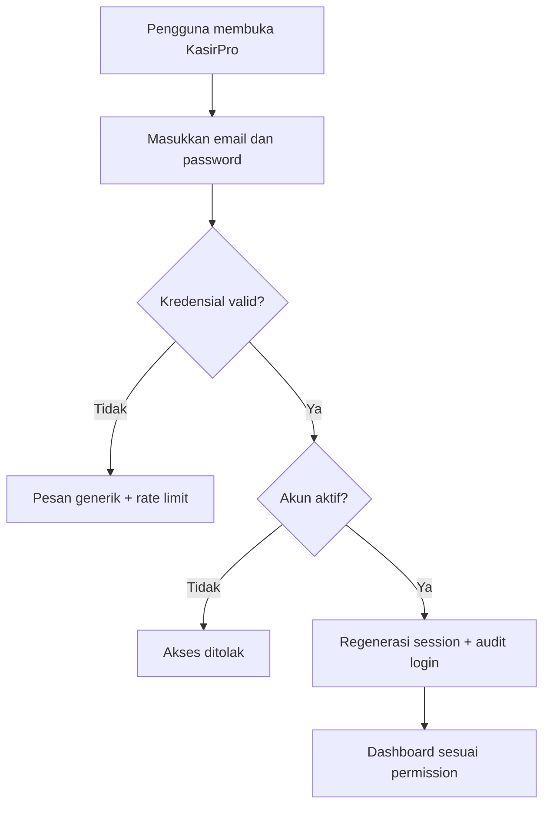

## 7.2 Sales flow — tunai

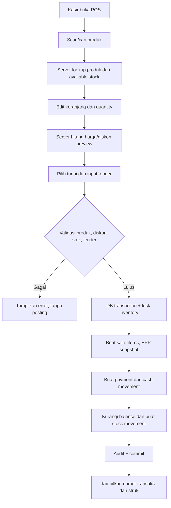

## 7.3 Sales flow — transfer manual

```mermaid
sequenceDiagram
    actor K as Kasir
    participant UI as Browser POS
    participant API as Laravel
    participant DB as MySQL/InnoDB
    actor S as Supervisor/Admin
    K->>UI: Checkout transfer
    UI->>API: POST checkout + Idempotency-Key
    API->>DB: Lock stok; buat pending sale + reservation TTL
    DB-->>API: Pending sale dan reservation
    API-->>UI: Menunggu verifikasi
    S->>UI: Periksa transfer secara manual
    UI->>API: POST verify transfer
    API->>DB: Lock sale, reservation, inventory; cek TTL
    alt Valid dan reservation aktif
        API->>DB: Post sale/payment/stock/cash/audit
        DB-->>API: Commit completed
        API-->>UI: Pembayaran terverifikasi
    else Ditolak atau kedaluwarsa
        API->>DB: Reject/expire dan release reservation
        API-->>UI: Gagal dengan alasan
    end
```

## 7.4 Return flow

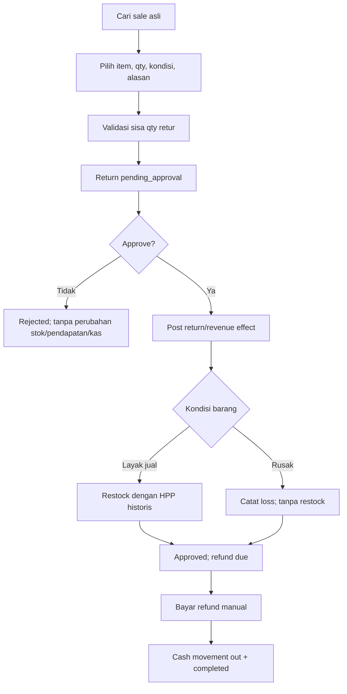

## 7.5 Purchase/receiving flow

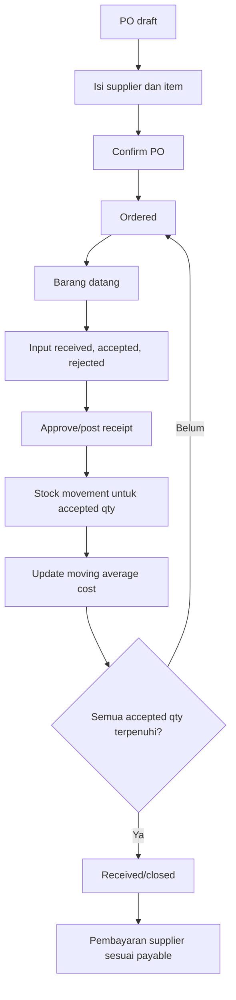

## 7.6 State machine — sale dan payment

Sale state dan payment state dipisahkan.

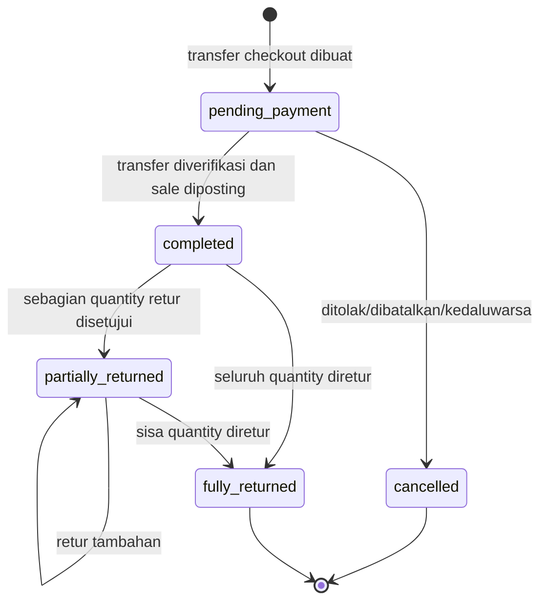

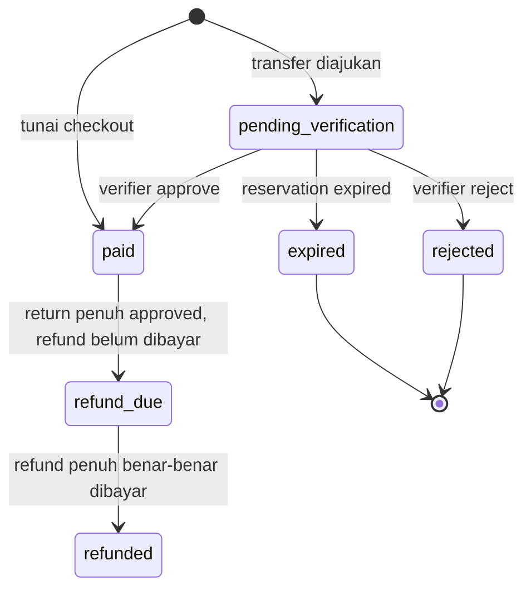

MVP hanya membayar refund penuh sekaligus; status parsial refund adalah future enhancement. Status sale tidak diturunkan dari status refund saja.

## 7.7 State machine — purchase

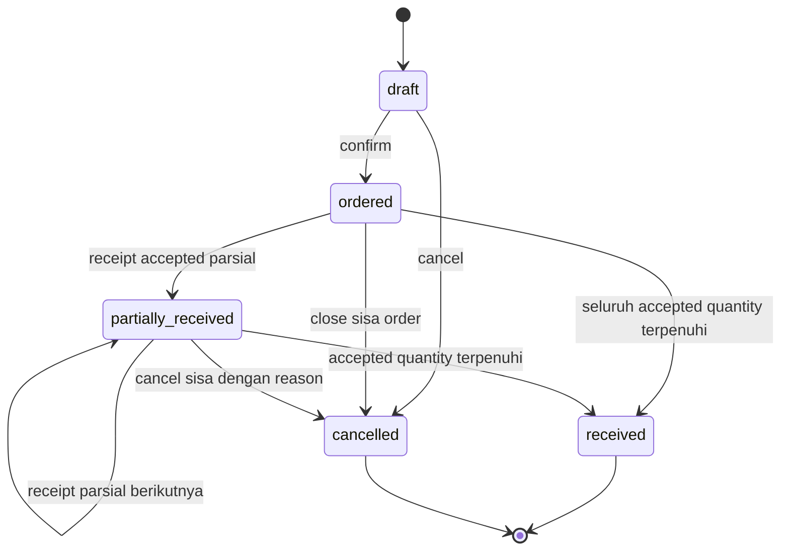

Status pembayaran purchase terpisah: `unpaid`, `partially_paid`, `paid`; status payment tidak mengubah status receipt. Outstanding payable dihitung dari nilai barang accepted yang telah diterima dan disahkan (ditambah biaya yang disepakati menjadi kewajiban) dikurangi pembayaran supplier yang sudah diposting. Uang muka pemasok sebelum receipt belum didukung sebagai skenario MVP; pembayaran supplier hanya dapat diposting sampai outstanding payable yang terbentuk dari receipt accepted.

## 7.8 State machine — return

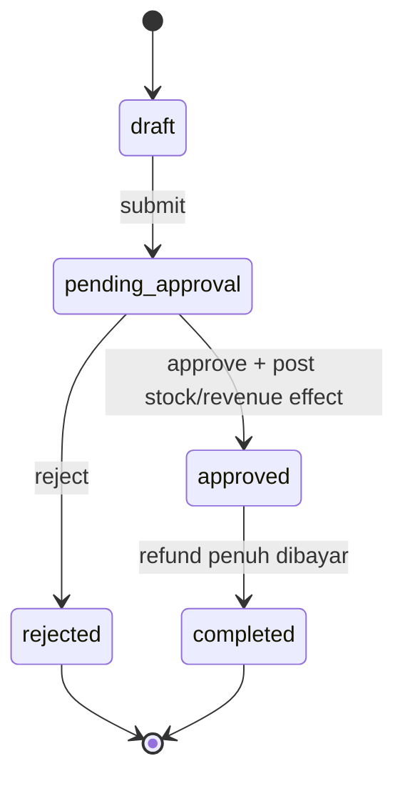

`approved` berarti barang/pendapatan retur telah diakui tetapi refund belum dibayar. `completed` berarti refund telah dibayar penuh. Dokumen posted tidak dihapus; koreksi memakai reversal.

## 7.9 State machine — stock opname

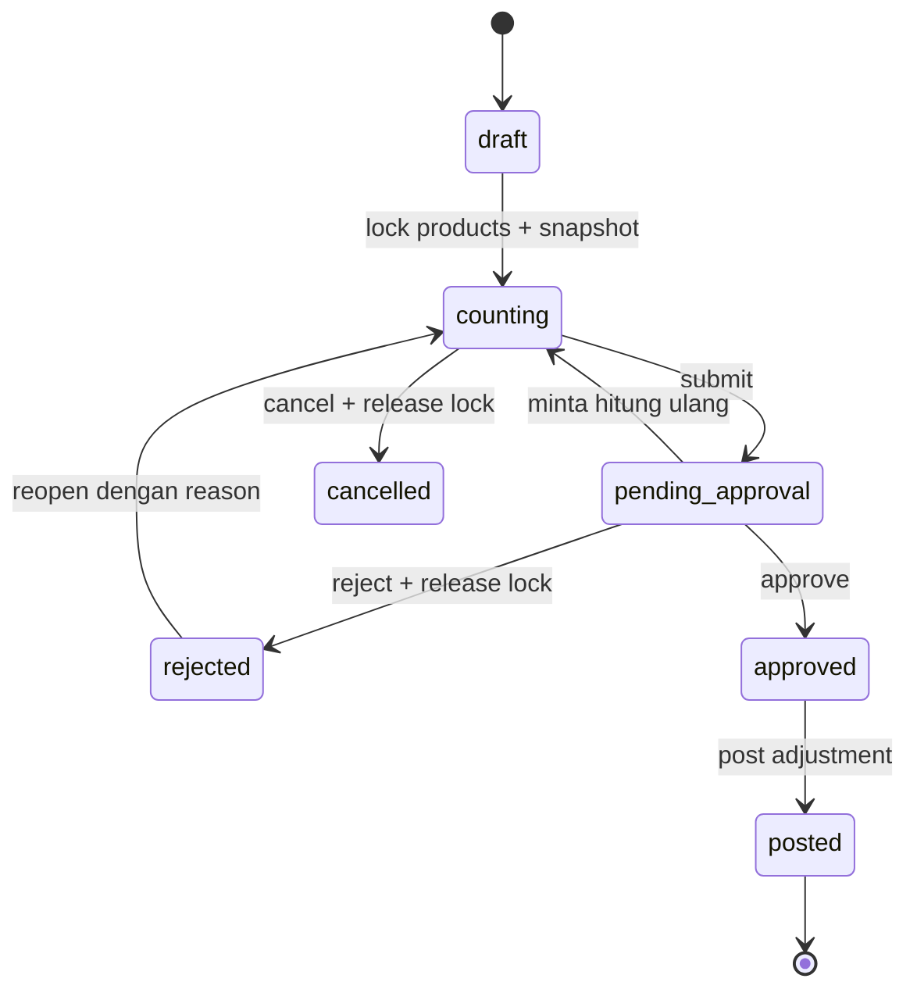

---

# 8. Business rules dan perhitungan

## 8.1 Money, quantity, rounding

- Uang `DECIMAL(15,2)`, quantity `DECIMAL(15,3)`, persentase `DECIMAL(7,4)`.
- Tidak menggunakan float/double untuk nilai finansial atau stok presisi.
- Perhitungan server menggunakan decimal-safe arithmetic.
- Rounding harus konsisten pada UI, database, laporan, PDF, dan XLSX.
- Nilai gross, discount, net, cost, dan snapshot sumber disimpan agar historis tidak dihitung ulang dari master yang berubah.

## 8.2 Discount allocation

1. Diskon item diterapkan sebelum diskon transaksi.
2. Diskon transaksi dialokasikan proporsional pada nilai item setelah diskon item.
3. Jika basis alokasi nol, diskon transaksi harus nol.
4. Total allocated discount tepat sama dengan header discount.
5. Residual rounding jatuh ke baris dengan basis terbesar; tie-break ID terkecil.
6. Retur menggunakan net amount historis yang sudah tersimpan.

## 8.3 Moving weighted average

Definisi `Q` = on-hand sebelum movement; `C` = average cost sebelumnya; `q_in` = accepted receipt quantity; `c_in` = landed cost/unit.

`new_average_cost = ((Q × C) + (q_in × c_in)) / (Q + q_in)` jika jumlah akhir >0.

Jika saldo sebelum receipt nol, average cost baru sama dengan landed cost receipt. Jika saldo setelah sale menjadi nol, current average cost diset 0; historical cost tetap ada pada sale item/cost history.

**Contoh:** 10 unit @Rp5.000 + 10 unit @Rp6.000 = 20 unit dengan average cost Rp5.500. Sale 5 unit memakai HPP snapshot Rp5.500 dan total COGS Rp27.500.

**Landed cost:** nilai accepted goods dikurangi allocated purchase discounts ditambah capitalizable receipt costs. Biaya yang tidak terkait langsung dengan perolehan persediaan dicatat sebagai expense. Receipt-level freight/cost dialokasikan proporsional terhadap nilai accepted item; sisa pembulatan dibagi deterministik.

**Sale COGS:** `quantity sold × cost snapshot at posting time`. Historical snapshot tidak berubah oleh receipt/return sesudahnya.

**Resellable return:**

`Q_new = Q_current + r`

`C_new = ((Q_current × C_current) + (r × historical_return_cost)) / Q_new`

Return damaged tidak menambah on-hand dan tidak membalik COGS menjadi persediaan tersedia; biayanya dicatat sebagai loss.

**Stock opname:** negative variance dinilai dengan average cost snapshot. Positive variance memakai average cost; jika tidak tersedia, supervisor harus memasukkan cost basis dan alasan.

## 8.4 Laba rugi sederhana

Periode laporan menggunakan tanggal pengakuan, bukan tanggal uang berpindah.

- `Gross sales` = gross total sale completed pada periode.
- `Sales discounts` = diskon item + diskon transaksi pada sale completed.
- `Sales returns` = nilai retur yang approved pada periode approval.
- `Net sales` = gross sales − sales discounts − sales returns.
- `Gross COGS` = total cost snapshot item sale completed.
- `COGS reversal` = historical cost dari retur resellable yang approved.
- `Net COGS` = gross COGS − COGS reversal resellable.
- `Gross profit` = net sales − net COGS.
- `Operating expenses` = expense posted pada periode pengakuannya.
- `Inventory loss` pada baris pengurang hasil operasional = shrinkage/stock-opname loss yang diposting. HPP barang retur rusak tetap berada pada `Net COGS` karena tidak ada COGS reversal; jangan kurangi lagi sebagai inventory loss. Nilai damaged-return dapat disajikan sebagai indikator informatif, bukan beban kedua.
- `Simplified operating result` = gross profit − operating expenses − stock-opname shrinkage loss.
- `Operating margin` = result / net sales × 100%; jika net sales nol tampilkan `—`.

Laporan tidak mencakup secara lengkap pajak, bunga, depresiasi, gaji yang tidak dicatat, dan penyesuaian akuntansi formal. Beri label **Laba Rugi Sederhana/Ringkasan Hasil Operasional**, bukan laporan keuangan formal.

## 8.5 Cash flow

- Cash flow berasal dari `cash_movements`, bukan created_at sale/purchase.
- Cash sale inflow sebesar grand_total, bukan tendered sebelum kembalian.
- Transfer inflow baru dibuat setelah verifikasi manual.
- Supplier payment, expense payment, dan refund menjadi cash outflow pada saat dibayar.
- Opening balance menjadi opening cash movement.
- Saldo akhir = opening balance + inflow − outflow.
- MVP melarang saldo akun negatif; transaksi melebihi saldo ditolak.
- Transfer antar akun (future) membuat movement out dan in berpasangan, bukan pendapatan/biaya.
- Koreksi kas dilakukan dengan reversal entry, bukan edit movement lama.

## 8.6 Stock rules

- `on_hand` = quantity fisik; `reserved` = bagian yang ditahan; `available = on_hand - reserved`.
- Sale memotong available stock; receipt accepted dan return resellable menambah on-hand.
- Pending transfer hanya menambah reserved.
- Reject/expire/cancel pending transfer melepas reserved.
- Produk yang sedang opname tidak menerima stock mutation.
- Saldo on-hand/reserved diubah dalam transaksi DB dengan row lock.
- Produk baru memiliki balance 0 dan average cost 0.
- Stok tidak diubah dari form produk.

## 8.7 Document number

Gunakan tabel sequence yang dikunci dalam transaksi; format contoh:

- `TRX-YYYYMMDD-00001`
- `PO-YYYYMMDD-00001`
- `RCV-YYYYMMDD-00001`
- `RET-YYYYMMDD-00001`
- `EXP-YYYYMMDD-00001`
- `SO-YYYYMMDD-00001`

Jangan memakai `MAX(id)+1`. Gap nomor dapat diterima; duplikasi tidak dapat diterima.

## 8.8 Date/time

- Tampilan waktu menggunakan `Asia/Jakarta`.
- Strategi penyimpanan UTC atau local datetime harus diputuskan sekali, diterapkan konsisten, dan diuji.
- Penjualan diakui pada `completed_at`; retur pada `approved_at`; expense pada tanggal pengakuan yang diposting; cash flow pada `paid_at/occurred_at`.
- Filter tanggal UI inklusif berdasarkan tanggal lokal dan dikonversi backend ke batas timestamp yang benar.

---

# 9. System architecture

## 9.1 Architectural style

Gunakan **modular monolith** Laravel MVC + Service Layer, Blade server-rendered, dan MySQL/InnoDB. Microservices atau SPA terpisah tidak diperlukan untuk MVP.

### Tanggung jawab lapisan

- **Routes:** URL, HTTP method, middleware.
- **Middleware:** authentication, permission, throttling, request context.
- **Form Requests:** validasi bentuk input.
- **Controllers:** orkestrasi request dan response; business logic tidak diletakkan di controller.
- **Services/Use cases:** menjalankan aturan bisnis dan transaksi multi-tabel.
- **Models:** persistence, relasi, casts, scopes sederhana.
- **Policies/Gates:** otorisasi resource/action.
- **Jobs:** ekspor besar dan tugas asynchronous.
- **Support:** money/quantity calculator, document sequence, date/time helpers.
- **Blade components:** UI reusable dengan Tailwind CSS.

## 9.2 System architecture diagram

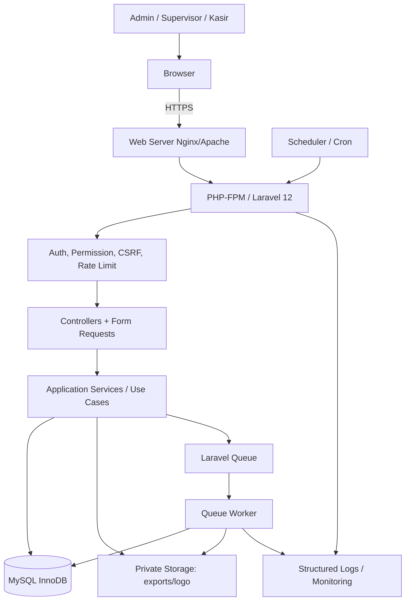

## 9.3 Batas modul

| Modul | Service/use case | Data utama |
|---|---|---|
| Identity/access | AuthenticationService, UserManagementService | users, roles, permissions, role_permissions |
| Catalog | ProductService, CatalogService | categories, units, products, price histories |
| Inventory | InventoryService, CostingService | inventory_balances, stock_movements, cost histories, reservations |
| Purchasing | PurchaseService, ReceivingService, SupplierPaymentService | purchases, purchase_items, receipts, supplier_payments |
| Sales | SaleService, PaymentVerificationService, ReceiptService | sales, sale_items, sale_payments |
| Returns | SalesReturnService, RefundService | sales_returns, return_items, return_payments |
| Cash/expenses | ExpenseService, CashMovementService | expenses, payments, cash_accounts, cash_movements |
| Stock opname | StockOpnameService | stock_opnames, stock_opname_items, locks |
| Reports | ReportService/query objects | query read-only atas domain data |
| Exports | ReportExportService, GenerateReportExport job | report_exports, private storage |
| Audit | AuditLogger | audit_logs |

## 9.4 Transaction boundaries

Setiap use case yang mengubah beberapa tabel harus menjadi satu DB transaction. Gunakan row-level lock pada inventory balance, sale/payment state, PO item receipt quantities, returnable quantities, sequence, dan cash account jika saldo dibatasi.

- **Checkout:** lock → validasi ulang data server → hitung → create sale/items/payment → stock movement → update balance → cash movement bila paid → audit → commit.
- **Receipt:** lock PO item + inventory → validasi sisa order → create receipt → stock movement → update balance/cost history → update PO state → audit → commit.
- **Return approval:** lock sale item + aggregate return quantity + inventory → validasi → approve → revenue return + stock/cost effect → audit → commit. Refund cash payment dapat terjadi pada transaksi terpisah saat benar-benar dibayar.
- Jika ada langkah gagal, seluruh perubahan pada transaksi tersebut rollback.

## 9.5 Queue/events

- Queue digunakan untuk ekspor besar dan housekeeping; transaksi bisnis inti tidak boleh bergantung pada queue untuk mem-post stok/kas.
- Audit dan ledger kritis dibuat sinkron dalam transaksi DB yang sama.
- Job harus retry-safe/idempotent dan mempunyai failed-job handling.
- Payload queue tidak menyimpan password, token, atau data sensitif yang tidak diperlukan.
- Scheduler melepas reservation yang expired, menghapus file ekspor expired, dan menjalankan housekeeping yang aman.

## 9.6 Scalability dan maintainability

- Skalakan vertikal lebih dahulu; modular monolith memadai untuk satu toko.
- Gunakan index, pagination, eager loading, agregasi SQL, dan query-plan review.
- Cache hanya data yang aman stale (misalnya daftar kategori); jangan gunakan cache saldo stok/harga sebagai sumber kebenaran checkout.
- Queue worker terpisah untuk ekspor.
- Redis/Elasticsearch/service tambahan tidak ditambahkan tanpa kebutuhan terukur.

---

# 10. Database schema

## 10.1 Konvensi database

- Engine InnoDB; character set `utf8mb4` dengan collation konsisten.
- PK `BIGINT UNSIGNED`; FK dan index ditentukan eksplisit.
- Money `DECIMAL(15,2)`; quantity `DECIMAL(15,3)`; rate `DECIMAL(7,4)`.
- Boolean `TINYINT(1)`; status berupa string pendek/backed enum dengan validasi aplikasi dan CHECK bila tersedia.
- Timestamp mengikuti satu kebijakan timezone yang konsisten.
- Ledger/history append-only pada level aplikasi; reversal membuat record baru.
- Master yang sudah direferensikan dinonaktifkan, bukan hard delete.
- Untuk tabel kritis, pilih FK langsung daripada mengandalkan pasangan polymorphic `type/id` tanpa integritas referensial.

## 10.2 Tabel inti

Kolom di bawah adalah logical schema minimum. Migration final wajib menambahkan nullability, default, FK action, CHECK constraint, dan index sesuai query nyata.

### Identity dan store

| Tabel | Kolom penting | Constraint/index |
|---|---|---|
| `roles` | id, code, name, description, is_system, timestamps | code UNIQUE; role system tidak dihapus |
| `permissions` | id, code, name, module | code UNIQUE |
| `role_permissions` | role_id, permission_id | composite PK/UNIQUE; FK ke roles/permissions |
| `users` | id, role_id, name, email, password, is_active, last_login_at, remember_token, timestamps | email UNIQUE; role FK RESTRICT; index is_active |
| `store_profiles` | id, store_name, logo_path, address, phone, email, website, receipt_footer, receipt_width, timezone, timestamps | satu profil aktif; width 58/80 |

### Catalog dan costing

| Tabel | Kolom penting | Constraint/index |
|---|---|---|
| `categories` | id, name, slug, description, is_active, timestamps | name/slug UNIQUE; index is_active |
| `units` | id, name, symbol, decimal_precision, is_active, timestamps | symbol UNIQUE; precision 0–3 |
| `products` | id, category_id, unit_id, sku, barcode nullable, name, description, selling_price, minimum_stock, is_active, timestamps | SKU UNIQUE; barcode UNIQUE nullable; FK RESTRICT; index name/category/status |
| `inventory_balances` | id, product_id, quantity_on_hand, quantity_reserved, average_cost, version, updated_at | product_id UNIQUE; nilai >=0; reserved <= on_hand |
| `product_price_histories` | id, product_id, old_price, new_price, changed_by, effective_at, reason, created_at | index product_id + effective_at |
| `product_cost_histories` | id, product_id, reference_type, reference_id, qty_before, cost_before, qty_after, cost_after, effective_at, created_by, created_at | index product_id + effective_at; source uniqueness sesuai type |

### Purchasing

| Tabel | Kolom penting | Constraint/index |
|---|---|---|
| `suppliers` | id, supplier_code, name, phone, email, address, contact_person, notes, is_active, timestamps | supplier_code UNIQUE; index name/status |
| `purchases` | id, purchase_number, supplier_id, order_date, expected_date, subtotal, item_discount_total, document_discount_total, additional_cost_estimate, payable_total, status, notes, created_by, confirmed_by/at, cancelled_by/at, cancel_reason, timestamps | purchase_number UNIQUE; FK RESTRICT; index status/date/supplier |
| `purchase_items` | id, purchase_id, product_id, product_name_snapshot, sku_snapshot, unit_snapshot, ordered_qty, unit_cost, line_discount, allocated_document_discount, accepted_qty_total, rejected_qty_total, cancelled_qty, line_total, timestamps | FK; index purchase/product; edit hanya saat draft |
| `purchase_receipts` | id, receipt_number, purchase_id, received_at, capitalizable_additional_cost, status, notes, received_by, posted_by, posted_at, timestamps | receipt_number UNIQUE; index purchase/status/date |
| `purchase_receipt_items` | id, receipt_id, purchase_item_id, product_id, physically_received_qty, accepted_qty, rejected_qty, landed_unit_cost, landed_total_cost, notes | accepted + rejected = physical received; FK RESTRICT |
| `supplier_payments` | id, payment_number, purchase_id, cash_account_id, method, amount, reference_number, paid_at, cash_movement_id, created_by, reversed_by, reversal_reason, timestamps | payment_number UNIQUE; cash movement UNIQUE nullable; amount >0 |

### Sales dan returns

| Tabel | Kolom penting | Constraint/index |
|---|---|---|
| `sales` | id, transaction_number, cashier_id, sale_status, payment_status, gross_total, item_discount_total, transaction_discount_total, grand_total, store_snapshot JSON, idempotency_key, pending_expires_at, completed_at, cancelled_at, cancellation_reason, notes, timestamps | transaction_number UNIQUE; idempotency key UNIQUE; FK user RESTRICT; index status/completed_at/cashier |
| `sale_items` | id, sale_id, product_id, product_name_snapshot, sku_snapshot, barcode_snapshot, unit_name_snapshot, quantity, unit_price_snapshot, gross_line_total, line_discount, allocated_transaction_discount, net_line_total, cost_price_snapshot, cost_total_snapshot, timestamps | FK RESTRICT; index sale/product |
| `sale_payments` | id, sale_id, payment_method, cash_account_id nullable until verify, amount, cash_tendered, change_amount, reference_number, verification_status, verified_by/at, paid_at, cash_movement_id, created_at | sale_id UNIQUE untuk MVP; cash movement UNIQUE nullable; index status/date |
| `stock_reservations` | id, sale_id, status, expires_at, released_at, created_at | sale_id UNIQUE; index status/expiry |
| `stock_reservation_items` | id, reservation_id, product_id, quantity | unique reservation_id + product_id |
| `sales_returns` | id, return_number, sale_id, requested_by, approved_by, status, return_date, gross_return_amount, approved_at, completed_at, reason, approval_note, timestamps | return_number UNIQUE; FK RESTRICT; index sale/status/date |
| `sales_return_items` | id, sales_return_id, sale_item_id, product_id, quantity, item_condition, unit_selling_price_snapshot, return_amount, cost_price_snapshot, cost_amount, restock_quantity, notes | FK RESTRICT; quantity >0 |
| `sales_return_payments` | id, sales_return_id, cash_account_id, method, amount, reference_number, paid_at, cash_movement_id, paid_by, created_at | satu full refund MVP; cash movement UNIQUE |

### Inventory, expenses, cash

| Tabel | Kolom penting | Constraint/index |
|---|---|---|
| `stock_movements` | id, product_id, movement_type, source_type, source_id, quantity_in, quantity_out, balance_before, balance_after, unit_cost, total_cost, notes, created_by, occurred_at, created_at | index product+date; qty >=0; satu arah positif sesuai movement |
| `expense_categories` | id, name, description, is_active, timestamps | name UNIQUE |
| `expenses` | id, expense_number, category_id, expense_date, description, amount, status, notes, created_by, posted_by/at, voided_by, void_reason, timestamps | number UNIQUE; amount >0; index date/status/category |
| `expense_payments` | id, expense_id, cash_account_id, method, amount, paid_at, reference_number, cash_movement_id, paid_by, created_at | cash movement UNIQUE; amount >0 |
| `cash_accounts` | id, code, name, account_type (`cash`/`bank`), opening_balance, opening_balance_at, is_active, timestamps | code UNIQUE; opening balance nonnegative |
| `cash_movements` | id, cash_account_id, movement_type, direction (`in`/`out`), amount, description, source_type, source_id, occurred_at, created_by, reversal_of_id, created_at | amount >0; index account+date; unique source/reversal link |
| `cash_adjustments` | id, adjustment_number, cash_account_id, direction, amount, category, reason, status, requested_by, approved_by, posted_at, cash_movement_id, timestamps | number UNIQUE; maker-checker; amount >0 |

### Stock opname, audit, export, sequence

| Tabel | Kolom penting | Constraint/index |
|---|---|---|
| `stock_opnames` | id, opname_number, status, started_at, submitted_at, approved_by/at, posted_at, created_by, notes, timestamps | opname_number UNIQUE; index status/date |
| `stock_opname_items` | id, stock_opname_id, product_id, expected_quantity, counted_quantity nullable, variance_quantity nullable, average_cost_snapshot, variance_value, counted_by/at, notes | unique opname+product; FK RESTRICT |
| `stock_opname_locks` | id, stock_opname_id, product_id, locked_at | unique active product lock; release after post/cancel |
| `audit_logs` | id, user_id nullable, action, module, reference_type/id, old_values JSON, new_values JSON, ip_address, user_agent, correlation_id, created_at | index actor/date/module/reference; no secrets |
| `report_exports` | id, user_id, report_type, format, filters JSON, file_path, status, error_code, requested_at, completed_at, expires_at, created_at | index user/status/date; private path |
| `document_sequences` | id, document_type, period_key, last_number, updated_at | unique document_type + period_key |
| `jobs`, `failed_jobs`, `sessions` | Laravel standard tables as required | standard migration and operational monitoring |

### Schema notes

- `inventory_balances` adalah saldo cache/projection; `stock_movements` adalah sumber audit. Buat rekonsiliasi ledger → balance.
- `cash_accounts.opening_balance` hanya input inisialisasi; buat opening `cash_movement` pada saat setup dan jangan edit saldo historis langsung.
- `reference_type/reference_id` dipakai hanya bila perlu untuk banyak sumber movement; sumber kritis harus memiliki foreign key langsung bila memungkinkan.
- Jangan cascade-delete transaksi posted atau ledger. FK master terhadap transaksi memakai RESTRICT.
- `store_snapshot` dapat JSON, tetapi schema final harus menetapkan struktur wajib dan versi snapshot.
- Setiap source posting harus mempunyai constraint/marker idempotent agar tidak diposting dua kali.

## 10.3 ERD Mermaid (inti)

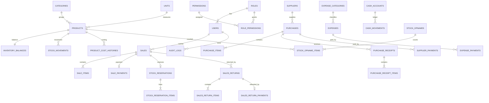

## 10.4 Index dan query strategy

Index minimum yang perlu dipertimbangkan: `products(sku)` UNIQUE, `products(barcode)` UNIQUE nullable, `products(name)`, `(category_id,is_active)`; `inventory_balances(product_id)` UNIQUE; `stock_movements(product_id,occurred_at,id)`; `sales(transaction_number)` UNIQUE, `(sale_status,completed_at)`, `(cashier_id,completed_at)`; `sale_items(sale_id,product_id)`; `sales_returns(sale_id,status,return_date)`; `purchases(supplier_id,order_date,status)`; `cash_movements(cash_account_id,occurred_at,id)`; `expenses(expense_date,status,category_id)`; `report_exports(user_id,status,requested_at)`.

Index akhir ditetapkan melalui `EXPLAIN` setelah dataset uji dibuat. Hindari index berlebihan pada kolom jarang difilter.

## 10.5 Migration strategy

1. Migration normal bersifat forward-only; jangan mengedit migration yang telah dijalankan di environment bersama.
2. Perubahan breaking dilakukan bertahap: tambah nullable/default → deploy kode kompatibel → backfill → validasi → enforce constraint → hapus kolom lama di rilis berikutnya.
3. Uji migration terhadap salinan database dan backup sebelum production.
4. Backfill besar dilakukan per batch dan dapat dilanjutkan setelah gagal.
5. Periksa FK/index/unique conflict dan estimasi lock duration.
6. Rollback tidak boleh menghapus data transaksi; gunakan forward-fix untuk data migration yang tidak aman dibalik.
7. `migrate:fresh` hanya untuk local/test, tidak untuk staging/production.

---

# 11. API specification

## 11.1 Prinsip API

MVP menggunakan Blade/server-rendered UI dengan endpoint JSON same-origin untuk interaksi POS dan beberapa modul. API bukan public third-party API.

- Prefix yang disarankan: `/api/v1`.
- Authentication: Laravel session cookie pada domain yang sama.
- CSRF wajib untuk method mutasi.
- `Content-Type: application/json` untuk JSON endpoints.
- Authorization melalui permission/Policy/Gate.
- Pagination: `page`, `per_page` default 20, maksimum 100.
- Sort hanya field whitelist.
- Tanggal filter `YYYY-MM-DD`, dipahami dalam `Asia/Jakarta`.
- `Idempotency-Key` wajib untuk checkout, verify/post payment, receipt, refund, stock opname posting, dan mutasi posting kritis.
- Nilai uang dan quantity dikirim sebagai string decimal agar presisi tidak hilang di JavaScript.

## 11.2 Standard response

Success:

```json
{
  "data": { "id": 123, "status": "completed" },
  "meta": { "request_id": "01J..." }
}
```

List:

```json
{
  "data": [],
  "meta": { "page": 1, "per_page": 20, "total": 0, "request_id": "01J..." }
}
```

Error:

```json
{
  "error": {
    "code": "INSUFFICIENT_STOCK",
    "message": "Stok tersedia tidak mencukupi untuk salah satu produk.",
    "details": { "items": [{ "product_id": 10, "requested": "5.000", "available": "3.000" }] }
  },
  "meta": { "request_id": "01J..." }
}
```

Jangan mengirim stack trace, SQL, secret, atau konten `.env` ke client.

## 11.3 Endpoint catalog

Semua endpoint berikut memerlukan session kecuali login. Permission aktual wajib mengikuti matriks §4.

| Method | Endpoint | Fungsi | Permission |
|---|---|---|---|
| POST | `/api/v1/auth/login` | Login JSON bila digunakan | public + rate limit |
| POST | `/api/v1/auth/logout` | Logout | authenticated |
| GET | `/api/v1/me` | Profil dan permission efektif | authenticated |
| GET/POST | `/api/v1/products` | List/create produk | products.view/create |
| GET/PATCH | `/api/v1/products/{id}` | Detail/update produk | products.view/update |
| GET | `/api/v1/products/lookup?q=` | Lookup nama/SKU/barcode | products.view |
| GET/POST | `/api/v1/categories` | List/create kategori | catalog.view/manage |
| GET/POST | `/api/v1/units` | List/create satuan | catalog.view/manage |
| GET/POST | `/api/v1/suppliers` | List/create supplier | suppliers.view/manage |
| GET/POST | `/api/v1/purchases` | List/create PO draft | purchases.view/create |
| GET/PATCH | `/api/v1/purchases/{id}` | Detail/update draft | purchases.view/update_draft |
| POST | `/api/v1/purchases/{id}/confirm` | Confirm PO | purchases.confirm |
| POST | `/api/v1/purchases/{id}/cancel` | Cancel/close sisa PO | purchases.cancel |
| POST | `/api/v1/purchases/{id}/receipts` | Create/post receipt | receipts.create/post |
| POST | `/api/v1/purchases/{id}/payments` | Supplier payment | supplier_payments.create |
| GET | `/api/v1/inventory/balances` | Saldo stok | inventory.view |
| GET | `/api/v1/inventory/movements` | Kartu stok | inventory.view |
| GET | `/api/v1/inventory/low-stock` | Low stock/out of stock | inventory.view |
| POST | `/api/v1/sales/checkout` | Checkout cash/transfer | sales.create |
| GET | `/api/v1/sales` | Daftar penjualan | sales.view_own/all |
| GET | `/api/v1/sales/{id}` | Detail/struk | sales.view_own/all |
| POST | `/api/v1/sales/{id}/verify-transfer` | Verifikasi transfer | payments.verify_transfer |
| POST | `/api/v1/sales/{id}/cancel` | Cancel pending transfer | sales.cancel_pending |
| POST | `/api/v1/sales/{id}/returns` | Ajukan retur | returns.request |
| POST | `/api/v1/returns/{id}/approve` | Approve | returns.approve |
| POST | `/api/v1/returns/{id}/reject` | Reject | returns.approve |
| POST | `/api/v1/returns/{id}/refund` | Bayar refund penuh | returns.refund |
| GET/POST | `/api/v1/expenses` | List/create expense | expenses.view/create |
| POST | `/api/v1/expenses/{id}/post` | Posting expense | expenses.post |
| POST | `/api/v1/expenses/{id}/payments` | Bayar expense | expenses.pay |
| POST | `/api/v1/stock-opnames` | Create opname | stock_opname.create |
| POST | `/api/v1/stock-opnames/{id}/start` | Start/count lock | stock_opname.count |
| PUT | `/api/v1/stock-opnames/{id}/items/{itemId}` | Simpan count | stock_opname.count |
| POST | `/api/v1/stock-opnames/{id}/submit` | Submit approval | stock_opname.submit |
| POST | `/api/v1/stock-opnames/{id}/approve` | Approve | stock_opname.approve |
| POST | `/api/v1/stock-opnames/{id}/post` | Post movements | stock_opname.post |
| GET | `/api/v1/reports/{reportType}` | Preview report | reports.view |
| POST | `/api/v1/report-exports` | Request PDF/XLSX | reports.export |
| GET | `/api/v1/report-exports/{id}` | Export status | owner / export_all |
| GET | `/api/v1/report-exports/{id}/download` | Download private file | owner/authorized |
| GET | `/api/v1/audit-logs` | Audit log | audit.view |

## 11.4 Request examples

### Product lookup

`GET /api/v1/products/lookup?q=8991234567890`

```json
{
  "data": {
    "id": 45,
    "sku": "SKU-0045",
    "barcode": "8991234567890",
    "name": "Air Mineral 600ml",
    "unit": { "symbol": "botol", "decimal_precision": 0 },
    "selling_price": "3500.00",
    "quantity_on_hand": "24.000",
    "quantity_reserved": "2.000",
    "available_quantity": "22.000",
    "stock_status": "available"
  }
}
```

### Checkout tunai

`POST /api/v1/sales/checkout` dengan header `Idempotency-Key: <UUID>` dan CSRF token.

```json
{
  "items": [
    { "product_id": 45, "quantity": "2.000", "line_discount_type": "amount", "line_discount_value": "0.00" }
  ],
  "transaction_discount_type": "amount",
  "transaction_discount_value": "500.00",
  "payment": {
    "method": "cash",
    "cash_account_id": 1,
    "cash_tendered": "10000.00"
  }
}
```

Server menghitung total, change, payment status, dan HPP. Client tidak mengirim nilai harga final yang dipercaya.

### Checkout transfer

```json
{
  "items": [{ "product_id": 45, "quantity": "1.000" }],
  "transaction_discount_type": "amount",
  "transaction_discount_value": "0.00",
  "payment": {
    "method": "bank_transfer",
    "cash_account_id": 2,
    "reference_number": "REF-MANUAL-001"
  }
}
```

Response `202 Accepted` atau `201 Created` dengan `sale_status=pending_payment`, `payment_status=pending_verification`, dan `reservation_expires_at`. Belum ada stock out atau cash inflow hingga verifikasi.

### Verifikasi transfer

`POST /api/v1/sales/{id}/verify-transfer`

```json
{
  "decision": "verified",
  "cash_account_id": 2,
  "verification_note": "Mutasi telah diperiksa manual"
}
```

Decision hanya `verified` atau `rejected`. Server mencatat verifier/time dan release reservation pada reject. Tidak boleh diverifikasi oleh requester kecuali Admin override.

### Pengajuan retur

```json
{
  "items": [
    { "sale_item_id": 901, "quantity": "1.000", "condition": "resellable", "reason": "Barang tidak sesuai" }
  ],
  "notes": "Retur sebagian"
}
```

Nilai retur dan HPP dihitung server dari snapshot; client tidak mengirim refund amount/cost yang dipercaya.

## 11.5 Validasi API per domain

| Domain | Validasi minimum |
|---|---|
| Product | name wajib; SKU unik; barcode unik nullable; kategori/unit aktif; price/min stock >=0 |
| Cart | tidak kosong; quantity >0; precision unit benar; line duplicate dinormalisasi; batas baris konfigurabel |
| Checkout | payment method valid; idempotency key; harga server; diskon valid; stok cukup; tender >= total |
| Transfer verify | sale/payment pending; reservation aktif; permission approver; akun aktif; nominal sesuai total |
| Purchase | supplier aktif; minimal satu item; qty>0; cost>=0; diskon <= basis |
| Receipt | PO eligible; accepted/rejected>=0; accepted+rejected=physical; accepted <= sisa order |
| Payment | amount>0; akun aktif; amount <= outstanding; sumber belum pernah dibayar ganda |
| Return | source sale selesai; qty <= remaining; condition/reason wajib; maker-checker |
| Expense | kategori aktif; amount>0; deskripsi/tanggal wajib; payment <= outstanding |
| Stock opname | state sesuai; item milik sesi; counted>=0; product lock aktif; approver berbeda |
| Export | report/format didukung; date range valid dan dibatasi; filter whitelist; permission |

## 11.6 HTTP status mapping

| HTTP | Makna |
|---|---|
| 200 | GET/update sukses |
| 201 | Resource dibuat atau posting selesai |
| 202 | Transfer menunggu verifikasi atau job asynchronous diterima |
| 204 | Sukses tanpa body |
| 400 | Request malformed |
| 401 | Belum login/session expired |
| 403 | Tidak memiliki permission |
| 404 | Resource tidak ada/tidak dapat diakses |
| 409 | Konflik stok/state/idempotency/lock |
| 422 | Validasi field/business rule gagal |
| 429 | Rate limit |
| 500 | Internal error |
| 503 | Dependency sementara gagal atau retry DB habis |

---

# 12. Tech stack dan dependensi

## 12.1 Baseline yang diminta

| Lapisan | Teknologi | Keputusan |
|---|---|---|
| Backend | Laravel 12 | Modular monolith, MVC, Service Layer |
| Runtime | PHP 8.2.29 sesuai versi yang disebut | Patch harus diperbarui sebelum production; lihat §12.2 |
| Database | MySQL 8.0.30 sesuai versi yang disebut | Patch lama; rencanakan MySQL 8.4 LTS untuk production |
| Storage engine | InnoDB | Transaksi, FK, row-level locking |
| Frontend | Blade | Server-rendered |
| CSS | Tailwind CSS | Utility-first; versi major ditetapkan melalui lock file setelah uji kompatibilitas |
| Asset bundler | Vite | Build CSS/JS |
| Interactivity | Alpine.js atau vanilla JS | Pilih pendekatan dominan; jangan menambahkan dua framework UI |
| Auth | Laravel session authentication | Cookie session + CSRF |
| Queue | Laravel Queue | Database driver untuk awal; Redis hanya bila dibutuhkan |
| Testing | PHPUnit atau Pest (pilih satu) | Unit, feature, integration; browser test bila dibutuhkan |
| Version control | Git | Pull request, review, tagged release |

## 12.2 Catatan dukungan versi

Versi di atas merupakan constraint awal dari pemilik produk, bukan jaminan bahwa patch tersebut merupakan pilihan produksi terbaik pada tanggal PRD.

- Dokumentasi resmi Laravel mencatat Laravel 12 mendukung PHP 8.2–8.5, bug fixes sampai 13 Agustus 2026, dan security fixes sampai 24 Februari 2027. Pada 17 November 2026, Laravel 12 sudah berada pada fase security-only. Rencanakan upgrade ke Laravel 13 sebelum masa keamanan Laravel 12 berakhir.
- PHP 8.2 mendapat security support sampai 31 Desember 2026. PHP 8.2.35 diumumkan pada 21 Oktober 2026 dan memperbaiki kerentanan kritis; karena itu PHP 8.2.29 tidak boleh dipakai sebagai patch production. Bila harus mempertahankan PHP 8.2, gunakan patch keamanan terkini yang tersedia dan rencanakan upgrade ke PHP 8.4 atau lebih baru.
- MySQL 8.0 mencapai community EOL pada April 2026 (rilis 8.0.46); Oracle menganjurkan upgrade ke MySQL 8.4 LTS atau jalur yang masih didukung. MySQL 8.0.30 tertinggal jauh dari patch seri 8.0 terakhir dan tidak disarankan untuk instalasi production baru.

**Production gate:** sebelum go-live, pemilik produk dan lead engineer menyetujui runtime yang masih didukung atau menandatangani penerimaan risiko dan rencana migrasi bertanggal. Rekomendasi target produksi adalah Laravel 13 + PHP 8.4 (patch terbaru kompatibel) + MySQL 8.4 LTS setelah uji regresi. Jika Laravel 12/PHP 8.2/MySQL 8.0 wajib dipertahankan, gunakan patch terbaru di masing-masing jalur yang tersedia dan dokumentasikan dukungan vendor. Jangan deploy tepat PHP 8.2.29/MySQL 8.0.30 sebagai environment produksi baru.

Referensi resmi diperiksa pada 17 November 2026:
- [Laravel Release Notes & Support Policy](https://laravel.com/docs/12.x/releases)
- [PHP Supported Versions](https://www.php.net/supported-versions.php)
- [PHP Release Announcements](https://www.php.net/)
- [MySQL 8.0 Release Notes](https://dev.mysql.com/doc/relnotes/mysql/8.0/en/)
- [MySQL Product Support EOL Announcements](https://www.mysql.com/support/eol-notice.html)

## 12.3 Runtime requirements

Pastikan ekstensi PHP yang dibutuhkan Laravel dan package final tersedia, sekurang-kurangnya Ctype, cURL, DOM, Fileinfo, Filter, Hash, Mbstring, OpenSSL, PCRE, PDO, PDO MySQL, Session, Tokenizer, dan XML. BCMath/GMP dapat dipakai untuk operasi decimal bila dipilih. Jalankan `composer check-platform-reqs` di CI dan server.

Contoh nama environment variable (bukan nilai rahasia aktual):

```dotenv
APP_NAME=KasirPro
APP_ENV=production
APP_DEBUG=false
APP_URL=https://domain-anda.example
APP_TIMEZONE=Asia/Jakarta

DB_CONNECTION=mysql
DB_HOST=127.0.0.1
DB_PORT=3306
DB_DATABASE=kasirpro
DB_USERNAME=kasirpro_app
DB_PASSWORD=<INJECT_FROM_SECRET_MANAGER>

SESSION_DRIVER=database
CACHE_STORE=database
QUEUE_CONNECTION=database
FILESYSTEM_DISK=private
LOG_CHANNEL=stack
```

`.env` aktual tidak boleh masuk Git atau dokumentasi publik. Konfigurasi `APP_TIMEZONE` harus benar-benar diterapkan di konfigurasi Laravel yang digunakan, bukan hanya ditulis sebagai environment variable.

## 12.4 Kandidat package

Package final ditetapkan setelah pemeriksaan kompatibilitas, lisensi, aktivitas pemeliharaan, dan security advisories:

- Excel: Laravel Excel/Maatwebsite atau library XLSX yang aktif dipelihara.
- PDF: Dompdf atau renderer HTML-to-PDF yang kompatibel; uji tabel lebar dan format cetak.
- Permission: permission sederhana internal atau package RBAC terpelihara; hindari kompleksitas berlebihan untuk tiga role.
- Decimal arithmetic: BCMath atau helper decimal; jangan gunakan floating point untuk total uang.

Commit `composer.lock` dan `package-lock.json`. Versi package tidak boleh ditetapkan hanya berdasarkan dugaan kompatibilitas tanpa menjalankan dependency resolution serta tests.

---

# 13. UI/UX requirements

## 13.1 Prinsip umum

- Bahasa antarmuka Indonesia dan terminologi konsisten.
- Format uang IDR konsisten di semua tampilan dan laporan, misalnya `Rp 1.234.567,00`.
- Tanggal dan waktu mengikuti `Asia/Jakarta`.
- Menu mengikuti permission, tetapi backend tetap menguji permission.
- Semua input memiliki label; field wajib diberi penanda; validasi tampil dekat field.
- Status tidak dibedakan hanya dengan warna; gunakan teks/badge dan ikon bila relevan.
- Aksi posting, refund, cancel, dan koreksi meminta konfirmasi yang menjelaskan konsekuensi.
- Setiap halaman utama memiliki loading, empty, validation, conflict, success, dan error state.

## 13.2 Layout aplikasi

- Sidebar berisi modul utama.
- Header memuat nama toko, user aktif, profil/logout.
- Breadcrumb untuk halaman bertingkat.
- Dashboard memakai cards dan grafik sederhana.
- Daftar data menggunakan filter, tabel, pagination, sort whitelist.
- Halaman detail dokumen memuat summary, status timeline, detail item, payment/stock effect, dan activity/audit section sesuai hak akses.
- Form panjang menggunakan section yang jelas dan ringkasan sebelum posting.

## 13.3 POS layout

Target utama desktop/tablet landscape:

- Panel kiri: barcode input, pencarian produk, filter kategori, hasil produk.
- Panel kanan: keranjang, quantity control, diskon, subtotal, grand total, payment panel.
- Input scan mudah difokuskan; Enter memproses satu barcode.
- Fokus scan kembali setelah proses.
- Tombol checkout memiliki loading state dan mencegah double-click; idempotency tetap menjadi kontrol utama.
- Grand total dan change terlihat jelas.
- Transfer pending menunjukkan status dan masa berlaku reservasi.
- Jika koneksi putus, UI tidak mengasumsikan sale sukses; status diperiksa dengan idempotency key sebelum retry.

## 13.4 Accessibility

Target awal adalah praktik WCAG 2.1 AA untuk komponen utama:

- Navigasi keyboard dan focus indicator terlihat.
- Label input terhubung secara semantik.
- Kontras teks memadai.
- Tabel memiliki header semantik.
- Modal mengelola focus dan mendukung keyboard.
- Error tidak disampaikan hanya melalui warna.
- Target sentuh nyaman pada tablet.
- Focus scanner tidak dihilangkan tanpa alasan.

## 13.5 Responsive

- POS dioptimalkan untuk desktop/tablet; mobile hanya view sederhana dalam MVP.
- Dashboard/laporan responsif; tabel boleh horizontal-scroll untuk kolom sekunder.
- Form master satu kolom di layar kecil, dua kolom pada layar lebih besar.
- Struk/PDF mempunyai stylesheet print sendiri, bukan memakai layout aplikasi.

## 13.6 UI state wajib

| State | Perilaku |
|---|---|
| Loading | Spinner/skeleton dan disable aksi duplikat |
| Empty | Pesan kontekstual dan CTA sesuai permission |
| Validation | Error per field; input aman dipertahankan |
| Business conflict | Alasan spesifik (stok berubah, dokumen posted, reservation expired) dan langkah berikutnya |
| Success | Konfirmasi dan nomor dokumen |
| Server error | Pesan umum + request ID; detail hanya pada log |
| Unauthorized | 403/redirect sesuai konteks; tidak membocorkan record |

---

# 14. Security requirements

## 14.1 Authentication dan session

- Password di-hash memakai hasher Laravel.
- Login dan endpoint sensitif menggunakan rate limit.
- Session diregenerasi setelah login dan perubahan privilege; logout menginvalidasi session.
- Cookie session menggunakan `HttpOnly`, `Secure` pada HTTPS, dan `SameSite=Lax` atau lebih ketat sesuai kebutuhan.
- CSRF protection untuk request mutasi same-origin.
- Session idle timeout configurable.
- Akun yang dinonaktifkan tidak boleh tetap dapat menggunakan session aktif setelah request berikutnya; invalidasi session harus diterapkan.
- Pesan login tidak mengungkap keberadaan email.

## 14.2 Authorization

- Default deny.
- Middleware permission pada route group.
- Policy memeriksa resource ownership.
- Semua approval menguji maker-checker.
- Download export memeriksa permission dan ownership.
- Hidden menu bukan kontrol keamanan.
- Test IDOR/horizontal privilege escalation dengan mengganti record ID pada URL.

## 14.3 Web/input/output security

- Server-side validation melalui Form Request.
- Gunakan Eloquent/Query Builder parameter binding; raw SQL harus binding dan direview.
- Blade auto-escaping; jangan render HTML tak tepercaya mentah.
- Terapkan CSRF.
- Upload logo memvalidasi MIME, extension, ukuran, dimensi, dan nama; simpan di storage yang tepat.
- Terapkan security headers yang sesuai: HSTS untuk HTTPS, X-Content-Type-Options, frame policy, Referrer-Policy, dan CSP yang sesuai build.
- Cegah open redirect, mass assignment, IDOR, XSS, SQL injection, CSRF, path traversal, dan spreadsheet formula injection.

## 14.4 Database dan secrets

- Aplikasi tidak memakai user DB root; privilege DB dibatasi.
- Batasi akses database ke jaringan aplikasi.
- Backup dienkripsi dan disimpan di lokasi berbeda.
- Secret disuntik dari environment/secret manager; tidak masuk source, log, PRD, audit payload, atau screenshot.
- `APP_DEBUG=false` di production.
- Audit tidak menyimpan password, token, cookie/session, secret, atau bukti transfer yang tidak diperlukan.

## 14.5 Integritas transaksi finansial/stok

- Sale, receiving, return approval, payment, dan stock opname posting atomic.
- Row locking untuk inventory, received quantities PO, returnable quantities, cash balance guard, dan sequence.
- Idempotency untuk operasi posting yang bisa terulang.
- Ledger append-only pada level aplikasi; reversal membuat entry baru dengan link ke source.
- Harga/diskon/cost dihitung ulang backend.
- Approval finansial dan inventory dicatat dalam audit.

## 14.6 Privasi dan retensi

MVP hanya menyimpan data akun kerja dan pemasok, tidak ada customer profile. Tentukan retensi untuk audit, export files, logs, dan backup sesuai kebutuhan bisnis/aturan lokal. Scheduler menghapus file ekspor yang expired tanpa menghapus transaksi atau ledger.

---

# 15. Error handling dan observability

## 15.1 Error taxonomy

| Kode | HTTP | Arti | Respons UI |
|---|---:|---|---|
| `VALIDATION_ERROR` | 422 | Field tidak valid | Error per field |
| `UNAUTHENTICATED` | 401 | Session hilang/expired | Login ulang |
| `FORBIDDEN` | 403 | Tidak ada permission | Akses ditolak |
| `NOT_FOUND` | 404 | Resource tidak ada/tidak dapat diakses | Kembali ke daftar |
| `INSUFFICIENT_STOCK` | 409 | Available stock kurang | Refresh stok dan ubah quantity |
| `PRODUCT_UNAVAILABLE` | 409/422 | Produk nonaktif | Hapus item dari keranjang |
| `IDEMPOTENCY_CONFLICT` | 409 | Key sama dipakai payload berbeda | Jangan submit ulang dengan key sama |
| `INVALID_STATE_TRANSITION` | 409 | State tidak mengizinkan aksi | Refresh detail dan tampilkan status |
| `RESERVATION_EXPIRED` | 409 | Reservasi transfer kedaluwarsa | Buat transaksi baru/eskalasi manual |
| `RETURN_QUANTITY_EXCEEDED` | 409 | Qty retur melebihi sisa | Refresh returnable quantity |
| `OPNAME_LOCKED` | 409 | Produk terkunci opname | Tampilkan sesi opname aktif |
| `BALANCE_INSUFFICIENT` | 409 | Saldo cash account tidak cukup | Pilih akun/koreksi sah |
| `EXPORT_FAILED` | 500/async failed | Generator gagal | Periksa status dan retry aman |
| `RATE_LIMITED` | 429 | Request terlalu sering | Tunggu lalu ulangi |
| `INTERNAL_ERROR` | 500 | Error tidak terduga | Pesan umum + request ID |

## 15.2 Logging

Structured log minimal: timestamp, level, environment, request/correlation ID, route, user_id bila ada, duration, error code, exception class. Jangan log password, session, CSRF token, secret, atau file privat.

- INFO: business event penting tanpa data rahasia.
- WARNING: conflict yang tertangani, invalid transition, retry.
- ERROR: failed job, exception tak terduga, DB failure.
- CRITICAL: indikasi kerusakan integritas data atau layanan utama.

## 15.3 Monitoring/alert

Pantau 5xx rate, latency P95 POS/report, queue pending/failed, koneksi DB, slow queries, storage usage, backup result, error checkout/receipt/refund, dan pending transfer/reservation expired. Alert menyertakan request ID tetapi tidak menyertakan data sensitif.

## 15.4 Retry policy

- Deadlock DB boleh retry terbatas di dalam transaksi.
- Jangan retry otomatis pembayaran/stok tanpa idempotency.
- Export job boleh retry dengan backoff dan export ID yang sama.
- Jika browser timeout saat checkout, query status berdasarkan idempotency key sebelum mengirim ulang.

---

# 16. Non-functional requirements

| ID | Area | Requirement |
|---|---|---|
| NFR-PERF-01 | POS lookup | P95 ≤ 500 ms pada data dan beban uji yang disepakati. |
| NFR-PERF-02 | Checkout | P95 ≤ 2 detik untuk tunai normal, tidak termasuk verifikasi transfer manual. |
| NFR-PERF-03 | Read pages | P95 ≤ 2,5 detik untuk daftar/dashboard standar. |
| NFR-PERF-04 | Reports | Report umum ≤ 5 detik pada dataset target; ekspor besar via queue. |
| NFR-SCALE-01 | Concurrency | Target awal 30 sesi bersamaan; revisi setelah profiling. |
| NFR-REL-01 | Availability | Target awal 99,5% per bulan di luar maintenance terjadwal. |
| NFR-DATA-01 | Consistency | Tidak ada negative stock; ledger dan balance harus dapat direkonsiliasi. |
| NFR-REC-01 | Recovery | RPO ≤24 jam dan RTO ≤4 jam sebagai target awal. |
| NFR-SEC-01 | Security | HTTPS, CSRF, session security, RBAC, audit, secret management, dependency scanning. |
| NFR-ACC-01 | Accessibility | Praktik WCAG 2.1 AA pada komponen utama. |
| NFR-MAINT-01 | Maintainability | Thin controllers, services, enums, tests, code review, docs as-built. |
| NFR-COMP-01 | Compatibility | Chrome/Edge versi terkini dan sebelumnya; scanner USB HID keyboard. |
| NFR-LOC-01 | Localization | Bahasa Indonesia, IDR, Asia/Jakarta, format konsisten. |
| NFR-OBS-01 | Observability | Correlation ID, structured logs, queue/backup monitoring. |

Target di atas adalah baseline perencanaan, bukan jaminan tanpa pengukuran. Uji harus menyebutkan server, data volume, concurrency, dan browser.

---

# 17. Testing requirements dan acceptance

## 17.1 Test strategy

| Layer | Framework/jenis | Fokus |
|---|---|---|
| Unit | PHPUnit atau Pest | Calculator, discount allocation, moving average, date range, document number |
| Feature | Laravel HTTP tests | Auth, permissions, CRUD, state transitions, validation, reports, export access |
| Integration | MySQL/InnoDB | Row locks, rollback, FK, unique, deadlock retry, idempotency |
| Browser/E2E | Dusk atau Playwright (pilih satu) | POS, scanner input simulation, modal, receipt view, report filters |
| Security | Automated + manual | IDOR, privilege escalation, CSRF, XSS, SQLi, upload, export injection |
| Performance | Load test | Lookup, checkout concurrent, dashboard, reports, queue |
| Recovery | Restore drill | Database + private file restore dan integrity check |
| UAT | Scenario based | Alur Admin/Supervisor/Kasir dan rekonsiliasi laporan |

## 17.2 Skenario kritis

### Sales & payment

- Tunai tepat, lebih (kembalian), kurang (ditolak).
- Stok pas, kurang, dan berubah setelah cart dibuat.
- Produk dinonaktifkan ketika ada di cart.
- Double submit key sama/payload sama dan key sama/payload berbeda.
- Dua kasir menjual stok terakhir; hanya satu yang berhasil.
- Transfer pending diverifikasi sebelum TTL.
- Transfer reject dan expiry melepas reservation.
- Verifikasi ganda tidak menciptakan cash/stock movement kedua.
- Exception setelah insert parsial menyebabkan rollback penuh.
- Browser timeout setelah commit: status transaksi dapat ditemukan dengan idempotency key.

### HPP & inventory

- Receipt cost berbeda mengubah moving average dengan benar.
- Partial receipt tidak mendobel accepted quantity.
- Rejected goods tidak masuk stok.
- Sale menyimpan HPP historis.
- Return resellable memulihkan stok dan biaya historis.
- Return damaged tidak menambah on-hand.
- Opname positive/negative dan produk terkunci.
- Ledger replay sama dengan inventory balance.

### Discount, return, profit

- Diskon item nominal/persen dan diskon transaksi.
- Header discount allocation dan residual rounding.
- Approval diskon tidak dapat dipalsukan dari browser.
- Retur bertahap tidak melebihi quantity awal.
- Retur memakai snapshot setelah diskon.
- Return approval membalik revenue, refund payment mengubah cash.
- Damaged return tidak menjadi COGS reversal resellable.
- P&L memakai tanggal retur approved, bukan refund paid date.

### Cash & expense

- Cash movement sale sebesar grand total, bukan tender.
- Supplier payment tidak menghasilkan movement ganda.
- Expense posted unpaid masuk P&L tetapi belum cash flow.
- Expense payment mengubah cash flow tanpa mengakui expense kedua kali.
- Void expense mempunyai reversal yang benar.
- Saldo akhir = opening + inflow - outflow.
- Payment di atas outstanding/saldo ditolak.

### Reports & exports

- Report totals sama dengan detail.
- Filter tanggal inklusif pada batas lokal.
- Perbandingan dengan periode dasar nol tidak membagi nol.
- Historical stock valuation memakai histori, bukan HPP sekarang.
- PDF/XLSX sama dengan preview.
- Formula injection disanitasi.
- User yang tidak berwenang tidak dapat mengunduh export orang lain.
- Failed export ditandai failed dan aman di-retry.

## 17.3 UAT checklist

- [ ] Admin mengelola pengguna, role, master, profil toko, laporan.
- [ ] Supervisor menjalankan approval sesuai permission.
- [ ] Kasir hanya mengakses transaksi dan fungsi yang diizinkan.
- [ ] Scanner USB berjalan pada setup yang didukung.
- [ ] Penjualan tunai menyimpan payment, stock, HPP, dan audit dengan benar.
- [ ] Transfer pending tidak mem-post stok/kas sebelum verifikasi.
- [ ] Reservation dilepas saat reject/expired/cancel.
- [ ] Accepted receipt memperbarui stok/HPP sekali saja.
- [ ] Return resellable dan damaged menghasilkan efek stok berbeda.
- [ ] Expense recognition dan pembayaran terpisah.
- [ ] P&L, cash flow, stock, product performance, valuasi dapat direkonsiliasi.
- [ ] PDF/XLSX dapat diunduh secara aman.
- [ ] Stock opname mengunci produk dan posting satu kali.
- [ ] Aksi sensitif tercatat pada audit log.
- [ ] Tidak ada critical/high security finding terbuka tanpa penerimaan risiko tertulis.
- [ ] Backup dapat direstore sesuai target RPO/RTO.
- [ ] README/docs sesuai implementasi yang diuji.

---


# 18. Deployment strategy dan operational readiness

## 18.1 Environment

| Environment | Tujuan | Data | Aturan |
|---|---|---|---|
| Local development | Pengembangan harian | Seed/factory sintetis | Tidak menggunakan data pelanggan/toko nyata tanpa anonimisasi. |
| CI/test | Unit, feature, integration test | Database disposable | Migration dijalankan dari nol; tidak memakai production credentials. |
| Staging | UAT dan rehearsal rilis | Data sintetis atau salinan yang dianonimkan | Konfigurasi sedekat mungkin dengan production. |
| Production | Operasional toko | Data aktual | HTTPS, debug off, backup, monitoring, akses minimum. |

## 18.2 Infrastruktur minimum

- Linux server yang masih mendapatkan pembaruan keamanan.
- Nginx atau Apache dengan document root hanya ke direktori `public/`.
- PHP-FPM dengan versi/patch yang disetujui pada production gate §12.2.
- MySQL InnoDB pada versi yang didukung vendor.
- TLS/HTTPS aktif dan diperpanjang otomatis.
- Private storage untuk export dan file yang tidak boleh diakses publik.
- Scheduler Laravel melalui cron.
- Queue worker dan process manager hanya bila queue digunakan.
- Log terpusat atau rotasi log yang mempunyai batas ukuran/retensi.
- Backup database dan file ke lokasi berbeda dari host aplikasi.

## 18.3 Release pipeline

1. Developer membuka pull request dan mengaitkan requirement/issue.
2. CI menjalankan format/lint, static analysis yang disepakati, dependency audit, unit/feature tests, migration test, dan build frontend.
3. PR memerlukan review minimal satu developer selain pembuat; perubahan security/finance/ledger perlu review lead engineer.
4. Merge ke branch rilis menghasilkan artefak dengan commit SHA/version tag.
5. Deploy ke staging; jalankan migration, smoke test, dan UAT terkait.
6. Ambil backup/pre-deployment snapshot sesuai risiko migration.
7. Deploy production dalam release window yang disepakati.
8. Jalankan migration yang kompatibel, clear/rebuild cache, build asset, restart worker, lalu smoke test.
9. Pantau error rate, failed jobs, checkout, payment verification, stok, dan database.
10. Catat release, operator, commit, migration, hasil smoke test, dan keputusan rollback/forward-fix.

## 18.4 Strategi migration dan rollback

- Migration production harus diuji pada dump yang telah disanitasi dan ukur perkiraan durasi/lock.
- Gunakan pola expand-and-contract untuk perubahan kolom besar atau breaking.
- Backup sebelum perubahan destruktif atau perubahan data berskala besar.
- Rollback kode hanya dilakukan jika skema tetap kompatibel dengan versi kode sebelumnya.
- Migration yang sudah merusak/menghapus data tidak boleh diasumsikan dapat di-rollback secara aman; siapkan forward-fix dan restore plan.
- Jangan menjalankan `migrate:fresh`, `db:wipe`, atau command reset di production.
- Dokumen runbook wajib menyebutkan command aktual setelah ditetapkan, prasyarat, efek, verifikasi, dan cara pemulihan.

## 18.5 Backup, restore, RPO, RTO

Target awal: RPO maksimum 24 jam dan RTO maksimum 4 jam. Target ini harus disetujui pemilik produk setelah mempertimbangkan nilai transaksi dan kemampuan infrastruktur.

- Backup database otomatis minimal harian; untuk kebutuhan operasional lebih tinggi, gunakan binary log/backup lebih sering setelah kapasitas disiapkan.
- Backup storage file penting: logo, dokumen, dan file ekspor yang masih dalam masa retensi.
- Backup dienkripsi saat transit dan saat disimpan di lokasi eksternal.
- Akses backup dibatasi dan dicatat.
- Uji restore terjadwal minimal per kuartal dan setelah perubahan besar infrastruktur.
- Uji restore harus mencakup verifikasi login, master data, transaksi, saldo inventory, cash movement, dan file.
- Retensi default awal: backup harian 14 hari dan mingguan 8 minggu; sesuaikan dengan storage, kebijakan, dan kebutuhan audit.

## 18.6 Health check dan operasi

Sediakan pemeriksaan berikut:
- Aplikasi merespons dan database dapat diakses.
- Queue worker aktif bila digunakan.
- Scheduler berjalan.
- Kapasitas disk, database, dan storage export memadai.
- Failed jobs dan error 5xx dipantau.
- Tidak ada file export privat yang melewati masa retensi tanpa cleanup.
- Rekonsiliasi inventory balance dengan stock ledger dapat dijalankan dan mismatch ditindaklanjuti.
- Rekonsiliasi cash account dengan cash movement dapat dijalankan.

## 18.7 Acceptance criteria deployment

- [ ] Environment staging dan production terpisah.
- [ ] Production memakai versi runtime yang disetujui pada §12.2.
- [ ] `APP_DEBUG=false`, TLS aktif, secret tidak ada di repository.
- [ ] Migration diuji dan mempunyai rencana pemulihan.
- [ ] Queue/scheduler berjalan sesuai konfigurasi.
- [ ] Backup berhasil dan restore drill telah lulus.
- [ ] Smoke test login, master data, checkout, laporan, dan unduhan privat lulus.
- [ ] Runbook deployment, rollback/forward-fix, backup, dan incident tersedia.

---

# 19. Standar dokumentasi proyek

## 19.1 Tujuan dan prinsip

Dokumentasi adalah bagian dari deliverable produk dan harus mencerminkan implementasi yang benar-benar berjalan. PRD ini menjadi sumber kebutuhan dan keputusan produk; dokumentasi teknis menjelaskan bagaimana kebutuhan tersebut diwujudkan. Jika implementasi berubah, dokumen terkait wajib diperbarui dalam pull request yang sama.

Prinsip:
1. Satu topik memiliki satu sumber kebenaran utama; dokumen lain menautkan, bukan menyalin seluruh isi.
2. Bedakan `Ditetapkan`, `Asumsi`, `Direncanakan`, `Diimplementasikan`, dan `Deprecated`.
3. Cantumkan tanggal atau versi untuk prosedur yang berubah mengikuti release.
4. Contoh konfigurasi menggunakan placeholder, bukan credential aktual.
5. Diagram disimpan sebagai Mermaid dalam Markdown agar dapat direview melalui Git.
6. Jangan mendokumentasikan endpoint, field, command, atau package seolah sudah tersedia bila belum ada di implementasi.
7. Setiap dokumen mempunyai owner (role/tim), tujuan, cakupan, status, last-reviewed, dan tautan silang yang relevan.

## 19.2 Struktur folder dokumentasi

```text
kasirpro/
├── README.md                    # pintu masuk proyek dan quick start
├── prd.md                       # salinan PRD yang disetujui; sumber kebutuhan produk
├── CHANGELOG.md                 # ringkasan rilis yang terlihat pengguna
├── CONTRIBUTING.md              # alur kerja Git, review, coding standards
├── .env.example                 # nama variabel dan placeholder non-secret
├── docs/
│   ├── index.md                 # daftar dokumentasi, audience, status, owner
│   ├── architecture.md          # komponen, boundary, alur dan keputusan arsitektur
│   ├── database.md              # schema, ERD, constraint, index, migration
│   ├── api.md                   # kontrak endpoint, request/response/error
│   ├── authentication.md        # session, login, authorization, permission
│   ├── business-rules.md        # perhitungan, status, validasi, invariant
│   ├── user-guide.md            # panduan Admin, Supervisor, Kasir
│   ├── deployment.md            # environment, build, deploy, rollback, restore
│   ├── testing.md               # framework, commands, data, test/UAT strategy
│   ├── troubleshooting.md       # diagnosis dan solusi masalah
│   ├── changelog.md             # perubahan teknis/arsitektur/detail domain
│   ├── security.md              # threat controls, secret, incident, data retention
│   ├── operations.md            # backup, monitoring, scheduled jobs, runbook
│   ├── decisions/
│   │   ├── 0001-modular-monolith.md
│   │   ├── 0002-moving-weighted-average.md
│   │   └── 0003-transfer-reservation.md
│   └── diagrams/
│       ├── system-context.mmd
│       ├── data-model.mmd
│       └── critical-flows.mmd
└── tests/
    └── ...                      # automated tests; test code tetap berada di proyek
```

File `.mmd` opsional. Jika renderer/preview repository tidak mendukung ekstensi `.mmd`, diagram dapat tetap ditanam pada dokumen Markdown terkait. Hindari menyimpan diagram duplikat yang dapat berbeda dari sumber.

## 19.3 Tujuan, cakupan, dan standar isi tiap dokumen

| Dokumen | Audience utama | Tujuan dan isi wajib | Kapan diperbarui |
|---|---|---|---|
| `README.md` | Semua developer/administrator | Deskripsi, status, fitur, tech stack, prasyarat, setup, env, migration/seed, cara menjalankan web/queue/scheduler, testing, build, tautan docs, troubleshooting awal. | Perubahan instalasi, stack, command, fitur utama, atau struktur proyek. |
| `prd.md` | Stakeholder, PM, UX, developer, QA | Tujuan, scope, requirements/ID, aturan, flows, acceptance, asumsi, prioritas, traceability. | Perubahan kebutuhan, keputusan produk, atau scope. |
| `docs/index.md` | Semua | Peta dokumentasi, owner, status implementasi, versi/tanggal review, tautan dokumen. | Dokumen ditambah/dihapus/diubah statusnya. |
| `docs/architecture.md` | Developer/lead | System context, component diagram, layer, boundaries, dependency direction, event/job, transaction boundaries, failure mode, scalability decision. | Komponen atau komunikasi berubah. |
| `docs/database.md` | Developer/DBA/QA | ERD aktual, tabel/kolom/type, PK/FK, nullability, unique/check constraints, indexes, snapshot/ledger, migration/backfill/rollback. | Setiap migration, constraint, index, atau perubahan model data. |
| `docs/api.md` | Frontend/backend/QA | Endpoint aktual, HTTP method/path, auth, permission, query/body, schema response, status code, validation, idempotency, pagination, error examples. | Route, request, response, status code, permission, atau error contract berubah. |
| `docs/authentication.md` | Developer/security/admin | Session lifecycle, login/logout, password policy, rate limit, CSRF, role/permission matrix, ownership policy, account deactivation. | Auth/session/permission berubah. |
| `docs/business-rules.md` | PM/developer/QA | HPP, diskon allocation, sales/return/purchase/expense states, stock invariants, cash vs P&L, date/time, rounding, reversal, approval. | Rumus atau aturan bisnis berubah. |
| `docs/user-guide.md` | Admin/Supervisor/Kasir | Langkah operasional per role, screenshot aktual, valid input, status, error umum, cetak struk, laporan. | UI/flow aktual berubah. |
| `docs/deployment.md` | DevOps/admin sistem | OS/runtime versi, extension, web server, env variable, build, migrate, queue, scheduler, storage permission, TLS, release/rollback/restore. | Infrastruktur, runtime, pipeline, atau command deploy berubah. |
| `docs/testing.md` | QA/developer | Framework, setup test, commands, fixtures, unit/feature/integration/concurrency/security/UAT, expected outcomes. | Test stack, coverage gate, atau skenario kritis berubah. |
| `docs/troubleshooting.md` | Support/admin/developer | Gejala, dampak, diagnosis aman, log/correlation id, solusi, eskalasi, larangan tindakan merusak data. | Insiden/masalah berulang atau prosedur berubah. |
| `docs/changelog.md` | Developer/QA/stakeholder | Detail perubahan teknis per release, breaking changes, migrations, config, API, security notes. | Setiap release/perubahan signifikan. |
| `CHANGELOG.md` | Pengguna/stakeholder | Fitur, perbaikan, breaking changes dengan bahasa ringkas dan versi/tanggal. | Setiap release. |
| `CONTRIBUTING.md` | Developer | Branch/PR workflow, code style, test requirements, review, commit, documentation DoD. | Workflow development berubah. |
| `docs/security.md` | Developer/ops | Security controls, secret handling, patching, access review, backup protection, incident procedure, retention. | Risiko/control/security practice berubah. |
| `docs/operations.md` | Administrator/ops | Backup schedule, restore test, scheduler, queue retry, monitor, reconciliation, retention, runbook. | Operasi produksi berubah. |
| `docs/decisions/*.md` | Lead/developer | ADR: konteks, opsi, keputusan, alasan, konsekuensi, status, tanggal. | Keputusan arsitektur penting diambil/diganti. |

Dokumen `security.md` dan `operations.md` ditambahkan karena produk memproses data transaksi, file export privat, stok, dan arus kas. Dokumen lain yang tidak relevan untuk sistem MVP dapat ditunda, tetapi dokumen yang memuat instruksi release, schema, API, auth, dan business rules wajib tersedia saat modul terkait dirilis.

## 19.4 Template minimum dokumen

```markdown
# Judul Dokumen

| Metadata | Nilai |
|---|---|
| Status | Planned / Draft / Active / Deprecated |
| Owner | Role atau tim |
| Versi/release berlaku | Versi atau commit/release |
| Terakhir ditinjau | YYYY-MM-DD |
| Sumber terkait | Link ke PRD/ADR/implementasi |

## Tujuan
## Cakupan
## Prasyarat / Konteks
## Detail / Prosedur
## Contoh atau diagram
## Validasi dan kondisi gagal
## Keamanan / risiko
## Acceptance / verifikasi
## Referensi silang
```

Template disesuaikan dengan dokumen; bagian yang tidak relevan boleh dihilangkan. Hindari boilerplate kosong.

## 19.5 Standar penulisan dan versioning

- Bahasa dokumentasi utama: Bahasa Indonesia; nama class, table, route, enum, dan API menggunakan nama teknis persis seperti kode.
- Gunakan heading bertingkat konsisten, tabel untuk field/permission, fenced code block untuk perintah, dan Mermaid untuk diagram.
- Gunakan format tanggal ISO `YYYY-MM-DD`; timestamp menyertakan zona waktu atau menjelaskan bahwa nilainya UTC.
- Gunakan istilah dan status yang didefinisikan di glossary serta business rules.
- Requirement memakai ID stabil; jangan memakai ulang ID yang sudah dihapus. Tandai `Deprecated` dan tautkan pengganti.
- Versioning PRD memakai semantic versioning dokumen: major untuk perubahan scope/aturan utama, minor untuk requirement baru, patch untuk koreksi tanpa mengubah makna.
- Changelog teknis memakai release date dan kategori Added, Changed, Fixed, Security, Deprecated, Removed.
- Tautan internal harus relatif dan dicek dalam CI bila tooling tersedia.
- Jangan masukkan dump data transaksi, PII, credential, token, password, private key, cookie, atau secret ke contoh.

## 19.6 Source of truth dan pencegahan duplikasi

- `PRD.md`: kebutuhan produk, prioritas, acceptance criteria, asumsi dan keputusan bisnis.
- `docs/business-rules.md`: aturan implementasi final; harus konsisten dengan PRD dan mencatat ID requirement asal.
- `docs/database.md`: schema aktual yang cocok dengan migration terakhir; jangan menjadikan diagram ERD manual sebagai pengganti migration.
- `docs/api.md`: kontrak endpoint aktual; route/controller/request test adalah bukti implementasi.
- `README.md`: quick-start dan tautan; jangan menyalin detail setiap dokumen lain.
- `CHANGELOG.md` dan `docs/changelog.md`: yang pertama ringkasan pengguna, yang kedua perubahan teknis lebih rinci.
- `docs/decisions/`: alasan keputusan; PRD menyimpan keputusan final ringkas dan menautkan ADR untuk sejarah diskusi.

Jika ada konflik, catat issue/ADR untuk menyelesaikannya. Jangan diam-diam membiarkan dua dokumen aktif menyatakan aturan berbeda. PRD yang sudah disetujui hanya diubah melalui review produk.

## 19.7 Matriks perubahan dan pembaruan dokumentasi

| Perubahan kode/produk | Dokumen wajib diperiksa/diperbarui |
|---|---|
| Modul/flow/acceptance baru | PRD, `docs/business-rules.md`, `docs/user-guide.md`, `docs/testing.md`, `docs/api.md` bila endpoint berubah |
| Migration/tabel/kolom/index | `docs/database.md`, `docs/architecture.md` jika boundary berubah, `docs/testing.md`, `docs/deployment.md` jika ada backfill/operational impact |
| Route/request/response/status API | `docs/api.md`, `docs/authentication.md` jika permission berubah, `docs/testing.md`, README bila setup berubah |
| Login/session/permission | `docs/authentication.md`, `docs/security.md`, `docs/api.md`, `docs/user-guide.md`, test terkait |
| Rumus HPP/diskon/retur/laba/arus kas | PRD, `docs/business-rules.md`, `docs/database.md` bila snapshot/ledger berubah, `docs/testing.md`, `docs/user-guide.md` |
| Arsitektur, queue, file storage | `docs/architecture.md`, ADR, `docs/deployment.md`, `docs/operations.md`, README |
| Environment/package/runtime | README, `.env.example`, `docs/deployment.md`, `docs/architecture.md` bila relevan, `docs/troubleshooting.md` |
| Security incident atau security control | `docs/security.md`, `docs/troubleshooting.md`, `docs/operations.md`, changelog bila berdampak pada pengguna |
| UI/UX flow | `docs/user-guide.md`, PRD bila requirement berubah, `docs/testing.md` |
| Release/perbaikan bug signifikan | `CHANGELOG.md`, `docs/changelog.md`, docs domain terkait |

## 19.8 Dokumentasi sebagai bagian Definition of Done

Pull request tidak dianggap selesai bila perubahan memengaruhi dokumentasi tetapi dokumen terkait belum diperbarui. Checklist wajib:

- [ ] Requirement/issue dan ID requirement dicantumkan.
- [ ] Acceptance criteria baru/lama dapat ditelusuri ke test.
- [ ] Dokumen sumber kebenaran diperbarui pada PR yang sama.
- [ ] Contoh API/schema/command telah dicocokkan dengan implementasi/test.
- [ ] Diagram tidak bertentangan dengan kode/migration.
- [ ] Tidak ada credential, secret, token, password, atau data riil sensitif.
- [ ] Tautan internal dan code fence valid.
- [ ] Deprecated docs ditandai dan link penggantinya diberikan.
- [ ] Changelog diubah bila perubahan masuk release.

## 19.9 Documentation acceptance criteria

| ID | Acceptance criteria yang dapat diverifikasi |
|---|---|
| DOC-01 | Developer baru dapat mengikuti README pada lingkungan bersih dan menjalankan aplikasi tanpa menebak perintah wajib. |
| DOC-02 | Diagram architecture menjelaskan aliran Browser → Laravel middleware/controller/request/service → MySQL/storage/queue sesuai implementasi. |
| DOC-03 | Setiap tabel, relasi, constraint, dan index penting pada `docs/database.md` cocok dengan migration terbaru. |
| DOC-04 | Endpoint, method, auth, permission, request, response, status, dan error pada `docs/api.md` cocok dengan route dan automated tests. |
| DOC-05 | `docs/authentication.md` menunjukkan role/permission aktual dan session/CSRF behavior. |
| DOC-06 | Aturan status, transisi, HPP, diskon, retur, stok, P&L dan cash flow pada `docs/business-rules.md` cocok dengan service dan tests. |
| DOC-07 | Admin, Supervisor, dan Kasir dapat mengikuti panduan sesuai tugas dan hak masing-masing. |
| DOC-08 | Prosedur deployment dari `docs/deployment.md` lulus rehearsal staging; migration/rollback/restore caveat jelas. |
| DOC-09 | Perintah pada `docs/testing.md` dapat dijalankan; suite dan acceptance tests menyebut expected result. |
| DOC-10 | `docs/troubleshooting.md` memberi diagnosis yang aman dan tidak menyarankan edit saldo/ledger langsung. |
| DOC-11 | Changelog mencatat perubahan yang sudah dirilis; perubahan belum rilis tidak diklaim sudah tersedia. |
| DOC-12 | Review docs dilakukan pada PR; CI memeriksa Markdown/link bila tooling telah dipasang. |

---

# 20. Prioritas MVP dan roadmap

## 20.1 MVP P0

P0 adalah kebutuhan minimum untuk menjalankan transaksi dan menjaga integritas data:

1. Fondasi Laravel, session authentication, tiga role, permission backend.
2. Kategori, satuan, produk, SKU/barcode, pemasok, harga jual, profil toko minimum.
3. Inventory balance, stock movements append-only, moving weighted average, cost history.
4. PO, penerimaan parsial/penuh, supplier payment manual.
5. POS, pencarian/barcode, cart, server-authoritative pricing, diskon dan approval, checkout tunai.
6. Transfer manual dengan verifikasi, TTL reservation, release saat ditolak/kedaluwarsa.
7. Receipt dan reprint.
8. Return partial/full dengan approval, kondisi resellable/damaged, refund manual.
9. Expense, kategori, pembayaran, cash movement.
10. Stok minimum/habis.
11. Laporan penjualan, pembelian, retur, biaya, laba rugi sederhana, arus kas.
12. PDF dan XLSX export dengan private download.
13. Audit log, backup/restore, error handling, automated tests, README dan dokumentasi teknis wajib.

## 20.2 P1 — rilis lanjutan atau sesudah MVP stabil

- Product performance.
- Valuasi persediaan historis.
- Perbandingan periode.
- Riwayat ekspor dan queue untuk export besar.
- Export audit, dashboard charts, dan monitoring operasional lanjutan.
- Cash adjustment non-operasional dengan maker-checker.
- Store branding dan thermal print refinements.

Stock opname tetap P0 sesuai ruang lingkup MVP dan harus tersedia sebelum go-live. P1 di atas merupakan perluasan/penyempurnaan analitik serta operasional setelah alur inti stabil.

## 20.3 P2 / di luar MVP

- Split payment dalam satu transaksi.
- Multi-cabang, multi-gudang, dan transfer stok.
- Customer/account/loyalty/credit sales.
- Akuntansi umum penuh, jurnal, buku besar, neraca, pajak.
- Sinkronisasi bank/payment gateway/QRIS API.
- Camera barcode scan, mobile native, marketplace.
- Unit conversion (karton/box/pcs) dan resep/bundling barang.
- Lot/batch, serial number, tanggal kedaluwarsa dan FEFO.
- Multi-currency dan multi-tax jurisdiction.
- Forecasting/AI.

P2 tidak boleh dibangun dengan mengubah aturan MVP secara diam-diam; perlu PRD change request dan desain dampak database/API/security.

---

# 21. Risiko, dependensi, edge cases, dan keputusan yang perlu dikonfirmasi

## 21.1 Risiko dan mitigasi

| Risiko | Dampak | Mitigasi/keputusan |
|---|---|---|
| Versi runtime sudah tua | Kerentanan keamanan dan keterbatasan package | Ikuti production gate §12.2; lakukan upgrade dan regression test. |
| Stok ganda/negatif saat concurrent checkout | Penjualan melebihi stok dan saldo salah | InnoDB transaction, `FOR UPDATE`, idempotency key, concurrency test. |
| Transfer terkonfirmasi terlambat | Reservation sudah kedaluwarsa atau stok berubah | TTL 15 menit asumsi awal; setelah expired tidak boleh memaksa post sale; prosedur cash adjustment/refund. |
| Return double processing | Stok/pendapatan/refund ganda | Lock sale item; aggregate returnable qty; unique posting marker; state machine. |
| HPP tidak akurat karena biaya tambahan | Laba dan nilai persediaan salah | Catat actual capitalizable landed cost pada receipt dan alokasikan ke item secara deterministik. |
| Retroactive backdate | Average cost historis dan valuasi dapat berubah | MVP melarang backdated stock posting sebelum waktu terakhir yang sudah diposting; koreksi via adjustment terotorisasi. |
| Saldo kas tidak cocok uang fisik | Laporan arus kas tidak akurat | Saldo awal terverifikasi, cash movement append-only, rekonsiliasi kas manual sebagai future/operational control. |
| Stock opname ketika toko menjual | Snapshot count tidak valid | Bekukan mutation produk yang dihitung; lock dilepas hanya saat post/cancel. |
| Export bocor | Informasi penjualan dan biaya terekspos | Private storage, authorization download, signed short-lived route bila diperlukan, expiry cleanup. |
| Kehilangan server | Kehilangan transaksi | Backup off-host, uji restore, RPO/RTO. |
| Laporan historis lambat | UX buruk saat transaksi tumbuh | Index, pagination, aggregate query, queue export, ukur query. |
| Salah konfigurasi timezone | Laporan harian tidak konsisten | Asia/Jakarta pada UI/report; aturan penyimpanan timestamp terdokumentasi; test batas tengah malam. |

## 21.2 Edge cases yang wajib diuji

### Product and unit
- Barcode kosong pada banyak produk diizinkan; barcode terisi harus unik.
- SKU/barcode mengandung nol di depan dan tetap diperlakukan string.
- Qty fractional diterima hanya sesuai precision satuan.
- Produk dinonaktifkan saat masih ada cart tidak boleh checkout.
- Harga berubah setelah item dimasukkan cart: backend memakai harga aktif saat checkout atau cart diminta refresh; keputusan MVP: harga backend saat checkout, konfirmasi ulang jika berubah material.
- Produk telah memiliki transaksi tidak bisa dihapus permanen.

### Sales and payment
- Double-click checkout, retry HTTP, browser timeout sesudah commit.
- Dua kasir checkout stok terakhir hampir bersamaan.
- Diskon nominal/persen melebihi nilai item, discount lebih besar dari subtotal, discount rounding residual.
- Uang tender kurang, tepat, atau lebih besar; kembalian harus tepat.
- Transfer di-reject, diverifikasi sebelum TTL, diverifikasi sesudah TTL, transfer duplikat/reference sama.
- Supervisor dan kasir mencoba verify transaksi yang sama bersamaan.
- Cash account nonaktif atau saldo tidak cukup saat posting/refund.
- Cetak struk gagal setelah transaksi commit: transaksi tetap completed dan tersedia reprint.

### Purchasing and cost
- Partial receipt beberapa kali sampai ordered qty habis.
- Duplicate receipt post karena retry.
- Barang diterima sebagian accepted, sebagian rejected.
- Supplier nonaktif setelah PO dibuat: dokumen lama tetap dapat diproses sesuai kebijakan, PO baru dilarang.
- PO dibatalkan setelah partial receipt: hanya sisa belum diterima yang ditutup; receipt posted tidak dibalik.
- Cost tambahan dialokasikan berdasarkan nilai accepted atau kuantitas accepted; satu metode tunggal harus dikonfigurasi dan dijelaskan di `business-rules.md`. Default MVP: proporsional terhadap nilai biaya item accepted.
- Quantity stock menjadi nol: average cost terakhir disimpan sebagai cost basis; ketika receipt berikutnya masuk ke stok nol, average cost menjadi landed cost receipt baru.
- Return restock menambah qty dan cost dengan historis cost snapshot.

### Return
- Jumlah retur parsial beberapa kali dan request bersamaan tidak boleh melebihi quantity terjual.
- Return item dengan allocated transaction discount rounding.
- Sale sudah sebagian/full returned.
- Approval ditolak: tidak mengubah stock/revenue/cash.
- Approval berhasil tetapi refund belum dibayar: status return tetap approved/refund_due, bukan completed.
- Refund dibayar dua kali: unique posting guard menolak pembayaran kedua.
- Barang rusak: tidak restock, tidak membalik COGS persediaan, catat damaged-return loss untuk pelaporan.

### Expense, cash, and reports
- Expense posted tetapi unpaid: P&L bertambah, cash tidak berubah.
- Expense paid sebagian: cash out sebesar payment; P&L expense tidak diakui ulang.
- Expense void setelah sebagian dibayar: wajib reversal cash dan pembalikan expense terukur; jika pengembalian dana belum terjadi, sisa pengembalian dicatat sebagai payable/receivable manual sesuai kebijakan operasional, jangan mengubah cash seolah sudah dikembalikan.
- Periode dengan penjualan bersih nol untuk margin.
- Periode pembanding nol.
- Retur approved hari ini tetapi cash refund dibayar esok: P&L pada approval date, cash flow pada paid_at.
- Supplier payment terjadi berbeda hari dari accepted receipt.
- Transfer internal antar akun tidak dianggap omzet/biaya; fitur transfer internal belum MVP.
- Backdated transaction tidak boleh menggeser average cost / ledger masa lalu tanpa proses restatement khusus.

### Stocktake and export
- Dua opname bersamaan pada produk yang sama harus ditolak oleh unique active lock.
- Opname dibatalkan setelah lock dibuka; jangan meninggalkan lock yatim.
- Item tidak dihitung sebelum submit harus ditolak atau secara eksplisit ditandai `not_counted`; default MVP: seluruh item sesi wajib mempunyai hasil hitung sebelum submit.
- Export job gagal/expired/permission berubah sebelum download.
- Data teks formula-like pada XLSX harus disanitasi.
- File export dihapus karena masa retensi; user menerima status expired dan dapat meminta export baru.

## 21.3 Dependensi

- Persetujuan runtime dan server environment.
- Pemilihan versi package PDF/XLSX dan license check.
- Browser dan printer thermal yang digunakan toko.
- Scanner USB yang bekerja sebagai keyboard wedge dan konfigurasi suffix Enter.
- Kebijakan manual verifikasi transfer dan siapa yang berwenang.
- Kebijakan jam operasional, tanggal transaksi, backdating, dan close period.
- Akun kas/bank awal dan saldo pembukaan yang diverifikasi.
- Data awal produk, saldo awal stok, dan HPP awal yang divalidasi.
- Prosedur operasional retur dan stok opname.

## 21.4 Keputusan asumsi yang digunakan pada PRD ini

| ID | Keputusan/asumsi MVP | Alasan | Perlu persetujuan |
|---|---|---|---|
| DEC-01 | Satu store profile, satu lokasi persediaan, satu mata uang IDR. | Membatasi kompleksitas MVP. | Ya, stakeholder |
| DEC-02 | Satu metode pembayaran per transaksi; cash atau transfer bank. | Sesuai kebutuhan awal dan menyederhanakan reconciliation. | Ya, stakeholder |
| DEC-03 | Transfer pending reserve stock selama 15 menit. | Menghindari penjualan berlebih sambil menunggu verifikasi. | Ya, Supervisor/pemilik |
| DEC-04 | Hanya Supervisor/Admin yang verify transfer; requester tidak boleh approve sendiri. | Maker-checker. | Ya, pemilik |
| DEC-05 | Return memerlukan approval; refund full satu kali pada MVP. | Menghindari return/refund ganda. | Ya, pemilik |
| DEC-06 | Moving weighted average; biaya perolehan yang memenuhi syarat dikapitalisasi. | Dasar HPP. | Ya, stakeholder/akuntan |
| DEC-07 | Stok opname membekukan produk yang sedang dihitung. | Akurasi expected vs counted. | Ya, operasional |
| DEC-08 | Kas/bank saldo negatif dilarang pada MVP. | Mencegah arus uang yang tidak tersedia. | Ya, pemilik |
| DEC-09 | Tanggal expense_date adalah tanggal pengakuan biaya; paid_at adalah tanggal kas keluar. | Pisahkan laba rugi dan cash flow. | Ya, stakeholder |
| DEC-10 | P0/P1 adalah usulan prioritas produk dari PRD; stakeholder dapat mengubah sebelum sprint commitment. | Membedakan kebutuhan inti dan tahap lanjutan. | Ya, product owner |

## 21.5 Pertanyaan yang belum menghalangi desain MVP

Pertanyaan berikut perlu dijawab sebelum implementasi modul terkait; bila tidak dijawab, asumsi DEC di atas dipakai:
1. Apakah toko mengizinkan backdated sales/receipts/expenses? Default: sales/payment tidak boleh backdate; expense date dapat berbeda dari posted_at dengan permission dan audit; stock movements tidak boleh diposting sebelum effective latest ledger date.
2. Bagaimana perlakuan biaya angkut/pajak pembelian? Default: hanya biaya perolehan yang dapat dikapitalisasi; pajak yang dapat dikreditkan tidak dimasukkan HPP, tetapi perlakuan pajak resmi memerlukan validasi akuntan.
3. Apakah penjualan transfer menahan stok selama 15 menit memadai? Sesuaikan TTL berdasarkan SOP toko.
4. Apakah stok opname wajib ada pada hari go-live? Bila ya, naikkan P1 menjadi P0.
5. Apakah pengembalian transfer harus ke rekening asal? Default MVP: catat akun tujuan dan reference secara manual; prosedur harus disetujui Supervisor/Admin.

---

# 22. Requirement traceability

Requirement IDs pada §5 menjadi identitas stabil. Matriks di bawah menghubungkan kelompok requirement ke implementasi, business rules, acceptance/test suites, dan dokumentasi utama. Nama test class bersifat rencana penamaan; nama aktual dapat disesuaikan dengan struktur test yang dipakai, tetapi relasi ID harus dipertahankan.

| Requirement ID | Implementasi utama | Business rule | Test/acceptance suite | Dokumentasi |
|---|---|---|---|---|
| FR-AUTH-01..05 | Auth controllers, middleware, policies | BR-AUTH-* | `AuthFeatureTest`, `AuthorizationFeatureTest` | README, authentication, api, security |
| FR-AUD-01 | Audit service/observer | BR-AUD-* | `AuditLogFeatureTest` | architecture, database, security |
| FR-MST-01..06, FR-STORE-01 | Master controllers/services/models | BR-MASTER-* | `MasterDataFeatureTest` | database, api, user-guide |
| FR-INV-01..07 | Product lookup, InventoryService, CostingService | BR-STOCK-*, BR-COST-* | `BarcodeFeatureTest`, `InventoryLedgerTest`, `MovingAverageCostTest` | database, api, business-rules |
| FR-PUR-01..05 | PurchaseService, ReceiptService, SupplierPaymentService | BR-PUR-*, BR-COST-* | `PurchaseFeatureTest`, `ReceiptConcurrencyTest`, `SupplierPaymentTest` | architecture, database, api, business-rules |
| FR-SAL-01..08 | SaleService, pricing, checkout, receipt | BR-SALE-*, BR-STOCK-* | `SaleCashFeatureTest`, `SaleTransferFeatureTest`, `ConcurrentCheckoutTest`, `IdempotencyTest` | api, database, business-rules, user-guide |
| FR-DIS-01..03 | DiscountCalculator, approval service | BR-DIS-* | `DiscountAllocationTest`, `DiscountApprovalTest` | business-rules, api |
| FR-RET-01..06 | ReturnService, refund payment | BR-RET-*, BR-COST-*, BR-CASH-* | `ReturnQuantityTest`, `ReturnStockCostTest`, `RefundPaymentTest` | api, business-rules, database |
| FR-OPEX-01..02 | ExpenseService, expense payments | BR-EXPENSE-*, BR-CASH-* | `ExpenseRecognitionTest`, `ExpensePaymentTest`, `ExpenseVoidTest` | business-rules, database, api |
| FR-CASH-01..03 | CashMovementService, CashAdjustmentService | BR-CASH-* | `CashLedgerTest`, `CashAdjustmentApprovalTest` | database, business-rules, security |
| FR-REP-01..06 | Reporting services/queries | BR-REPORT-* | `SalesReportTest`, `ProfitLossReconciliationTest`, `CashFlowTest`, `HistoricalValuationTest` | api, business-rules, testing |
| FR-EXPORT-01..03 | Export controller/jobs/private storage | BR-EXPORT-* | `PdfExportTest`, `XlsxExportTest`, `ExportAuthorizationTest` | api, deployment, security |
| FR-STO-01..02 | StockOpnameService/locks | BR-OPNAME-* | `StockOpnameFeatureTest`, `StockOpnameConcurrencyTest` | database, business-rules, user-guide |
| FR-OPS-01..02 | Backup/monitoring/runbooks | BR-OPS-* | `BackupRestoreDrill`, `OperationalSmokeTest` | deployment, operations, troubleshooting |

## 22.1 Business rule identifier convention

Gunakan ID domain untuk rule yang dirujuk lintas modul:
- `BR-AUTH-*`: authentication/authorization.
- `BR-AUD-*`: audit.
- `BR-MASTER-*`: master data.
- `BR-STOCK-*`: stock invariants/movement.
- `BR-COST-*`: moving weighted average and cost snapshots.
- `BR-PUR-*`: purchase/receiving/payable.
- `BR-SALE-*`: sales/payment.
- `BR-DIS-*`: discount.
- `BR-RET-*`: return/refund.
- `BR-EXPENSE-*`: expense recognition.
- `BR-CASH-*`: cash ledger.
- `BR-REPORT-*`: reporting period/formula.
- `BR-EXPORT-*`: report export and access.
- `BR-OPNAME-*`: stocktake.
- `BR-OPS-*`: operations/backup.

Tambahkan ID tersebut pada `docs/business-rules.md` ketika rule diimplementasikan. Jangan membuat ID baru hanya untuk setiap kalimat; ID harus stabil dan merujuk ke invariant/perilaku yang diuji.

## 22.2 Change impact workflow

Setiap change request harus:
1. Mengidentifikasi requirement ID yang berubah atau requirement baru.
2. Mengidentifikasi affected business rules, status, permissions, API, tables/migrations, UI flows, dan reports.
3. Memperbarui acceptance criteria dan tests sebelum/bersamaan dengan code.
4. Memperbarui traceability matrix dan docs terkait.
5. Meminta persetujuan product owner untuk perubahan scope/keputusan bisnis.

---

# 23. Definition of Done (DoD)

Satu requirement/fitur dinyatakan selesai jika seluruh butir relevan berikut terpenuhi:

## 23.1 Product dan behavior
- [ ] Requirement ID, prioritas, scope, input, output, precondition, validation, success, failure, dan acceptance criteria jelas.
- [ ] Role/permission dan ownership rule sudah ditentukan.
- [ ] Status dan transisi tidak menimbulkan state invalid.
- [ ] Edge case relevan sudah ditangani.
- [ ] Tidak ada conflict dengan stok, HPP, kas, laporan, atau historis.

## 23.2 Engineering dan data integrity
- [ ] Controller tipis; validasi di Form Request; business logic di service/domain layer.
- [ ] Query aman dan otorisasi ditegakkan di backend.
- [ ] Operasi multi-record kritis menggunakan DB transaction dan locking yang sesuai.
- [ ] Idempotency/unique constraint melindungi posting dari duplikasi.
- [ ] Snapshot historis dan source reference disimpan.
- [ ] Ledger stock/cash append-only; reversal/correction memiliki reason dan actor.
- [ ] Migration/index/FK/constraint telah direview dan diuji.
- [ ] Tidak ada secret atau data sensitif di Git/log/response.

## 23.3 Quality dan verification
- [ ] Unit test perhitungan dan feature tests alur utama lulus.
- [ ] Negative permission tests lulus.
- [ ] Concurrency/idempotency tests dibuat untuk jalur transaksi kritis.
- [ ] Regression suite lulus pada target DB engine/version yang disetujui.
- [ ] Accessibility dan responsive behavior utama diperiksa.
- [ ] Tidak ada critical/high security issue tanpa mitigasi dan risk acceptance tertulis.
- [ ] Acceptance criteria diverifikasi oleh QA/product owner.

## 23.4 Documentation dan release
- [ ] Docs sesuai implementasi aktual dan diperbarui dalam PR yang sama.
- [ ] API/schema/diagram contoh cocok dengan code/migration/test.
- [ ] README/setup/env/test/deploy masih dapat dijalankan.
- [ ] User guide diperbarui jika perilaku/tampilan pengguna berubah.
- [ ] Changelog dan versioning diperbarui saat release.
- [ ] Release note menyebut migration, configuration, breaking change, dan known issue.

---

# 24. Glossary dan status dokumen

| Istilah | Definisi |
|---|---|
| POS | Point of Sale; layar dan proses transaksi penjualan. |
| SKU | Kode internal unik untuk produk. |
| Barcode | Kode pemindaian produk, unik jika digunakan. |
| HPP/COGS | Biaya perolehan barang yang telah terjual. |
| Moving Weighted Average | Metode perhitungan HPP rata-rata bergerak setelah receipt/return stock. |
| Stock movement | Catatan immutable setiap penambahan/pengurangan kuantitas stok. |
| Inventory balance | Saldo stok cepat yang harus dapat direkonsiliasi terhadap ledger. |
| Cash movement | Catatan uang masuk/keluar yang benar-benar terjadi. |
| Receipt | Dokumen penerimaan barang terhadap PO. |
| Returnable quantity | Jumlah item penjualan yang belum pernah diretur secara approved/posted. |
| Resellable return | Barang retur yang layak kembali menjadi persediaan jual. |
| Damaged return | Barang retur yang tidak dapat dijual kembali. |
| Reservation | Kuantitas stok yang sementara dialokasikan untuk pending transfer. |
| Idempotency key | Kunci unik untuk memastikan retry request tidak menimbulkan efek ganda. |
| Snapshot | Salinan nilai historis saat transaksi terjadi, tidak berubah mengikuti master. |
| Maker-checker | Pengaju dan pemberi persetujuan merupakan pengguna berbeda, kecuali override terotorisasi dan diaudit. |
| P&L | Laporan laba rugi; pada MVP hanya ringkasan operasional sederhana. |
| RPO | Maksimal kehilangan data yang dapat diterima dihitung sebagai rentang waktu. |
| RTO | Target waktu pemulihan layanan setelah gangguan. |
| UAT | User Acceptance Testing oleh stakeholder/pengguna peran target. |

## Status PRD

Dokumen ini merupakan **baseline kebutuhan dan desain target** KasirPro. Dokumen ini bukan bukti bahwa aplikasi, endpoint, migration, test suite, atau dokumentasi proyek telah dibuat maupun diverifikasi. Semua tabel, endpoint, class, test name, diagram, dan struktur dokumentasi yang ditulis di sini adalah rancangan yang harus dibandingkan dengan implementasi aktual selama pengembangan.

Sebelum sprint pertama dimulai, product owner/representatif toko perlu menyetujui setidaknya: production runtime, TTL transfer reservation, kewenangan approval, perlakuan landed cost dan pajak, backdating/period close, refund policy, opening stock/cost, serta apakah stock opname harus termasuk go-live MVP.

**Akhir PRD — KasirPro v1.0.0**
